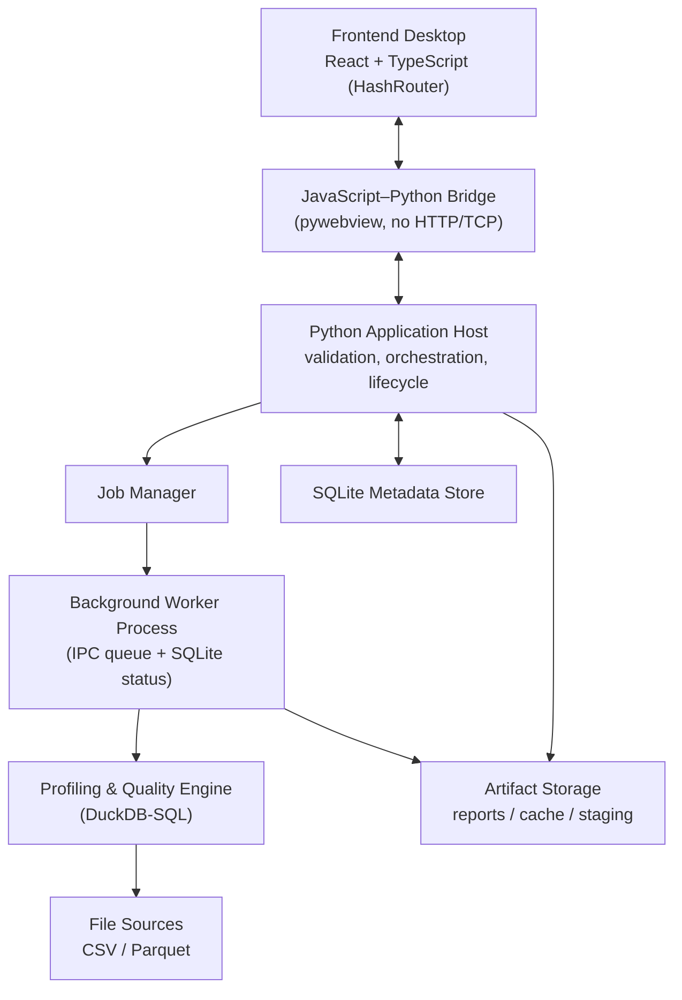

# Architecture & Architecture Decision Records

> [!NOTE] Relationship to other docs
> This document defines **system structure and the decisions behind it**. It resolves conflicts C1–C4 (see [[BLUEPRINT]] §4). Interfaces between components are specified in [[CONTRACTS]]; computational behavior in [[ENGINE_SPEC]].

## 1. Architecture style

**Modular monolith** — one Python backend, clearly separated internal modules, no microservices, no embedded HTTP server. The modules communicate through direct function calls and the in-process contracts; heavy computation runs in a separate OS process (worker) for isolation, not for service decomposition.

The frontend (React) is a thin presentation layer. Python owns all analytics and application logic.

## 2. System layers



### 2.1 Component responsibilities

| Component | Responsibility | Not responsible for |
|---|---|---|
| Frontend | User input, dashboard, tables, charts | Business rules, statistics computation |
| Bridge | Command/response/event transport between JS↔Python | Being a general-purpose Python RPC surface (locked facade only) |
| Application Host | Request validation, orchestration, app lifecycle | Running heavy analysis on the UI thread |
| Job Manager | Job id, status, progress, cancel, timeout, recovery | Data processing |
| Worker Process | Heavy profiling & quality execution | Owning UI state |
| Profiling & Quality Engine | Metrics, distributions, checks, findings, recommendations | Presentation, persistence policy |
| SQLite Metadata Store | Registry, runs, jobs, config versions, findings metadata | Storing large blobs |
| Artifact Storage | Reports, exports, staging, cache | Metadata queries |

## 3. Module boundaries (backend package layout)

```text
data_profiling_engine/
├── connectors/          # CSV, Parquet readers → DuckDB relations (MVP: no Excel/SQL)
├── discovery/           # schema inference, semantic types, dataset metadata
├── engine/              # metric registry + profilers (see ENGINE_SPEC)
│   ├── metrics/         # statistical, categorical, missingness, uniqueness, distribution, temporal
│   └── planner.py       # execution planner: exact / approximate / sampled decision
├── quality/             # rule registry, rule compiler (→ DuckDB SQL), executor, assessment
├── findings/            # detectors, deduplication, prioritization, fingerprinting
├── recommendations/     # rule-based templates, narrative assembly
├── orchestration/       # execution plan, job manager, runner, worker entrypoint
├── storage/             # metadata_store (SQLite), artifact_store, migrations
├── duckdb_session.py    # the ONLY place a DuckDB connection is opened: owned memory + spill ceilings (ADR-021)
├── reporting/           # visualizations, HTML report (inline Plotly), JSON writer, CSV export
├── bridge/              # pywebview facade, command handlers, DTO validation (pydantic)
├── schemas/             # canonical JSON schemas for all contracts (single source of truth)
├── cli/                 # profiler-cli (internal Phase-1 harness)
└── tests/
```

> [!IMPORTANT] No `api/` HTTP module
> The reference architecture listed an optional `api/` (FastAPI) directory. Per **ADR-005 / conflict C3**, there is **no HTTP/TCP application server**. Integration happens through the bridge facade only. Do not create a `FastAPI` app "for convenience" in dev mode.

## 4. Data flow (single run)

```mermaid
sequenceDiagram
    participant U as Analyst (UI)
    participant B as Bridge
    participant H as Application Host
    participant J as Job Manager
    participant W as Worker
    participant E as Engine (DuckDB)
    participant S as SQLite + Artifact Store

    U->>B: profile.start(dataset_id, mode)
    B->>H: validated command
    H->>J: create job (QUEUED)
    J->>W: spawn worker with job payload
    W->>E: open source read-only; plan; run profilers + rules
    E-->>W: ColumnProfiles, QualityCheckResults
    W->W: build Findings + Recommendations
    W-->>J: progress events (steps completed)
    W->>S: persist result JSON, artifacts, run metadata
    W-->>J: SUCCEEDED
    H-->>B: status + result references
    B-->>U: report + visualizations + assessment
```

## 5. Architectural Decision Records

Each ADR: Context → Decision → Alternatives → Consequences → Validation. Statuses: **Accepted** (binding) / **Proposed** (needs spike).

### ADR-001 — Target macOS and Windows — Accepted
- **Context:** analysts use both OS.
- **Decision:** both are official targets; native build per OS.
- **Consequences:** cross-OS WebView testing; separate installer pipelines; `multiprocessing` spawn semantics on both.
- **Validation:** Phase-0 spike installs and runs on each OS.

### ADR-002 — Local desktop installer distribution — Accepted
- **Decision:** ship installers; runtime bundled; no cloud data egress.
- **Consequences:** packaging complexity; see [[SECURITY_PACKAGING]].

### ADR-003 — pywebview as desktop host — Accepted
- **Decision:** pywebview provides window + WebView + JS–Python bridge.
- **Alternatives rejected:** Electron (size/duplication), Tauri (Rust backend, breaks "Python is the center"), pure local web app (violates ADR-005).
- **Consequences:** WebView engine differs per OS (WKWebView / WebView2); bridge is request/response, so **progress is polled** (see CONTRACTS §5.5).
- **Validation:** bridge round-trip proven in packaged build.

### ADR-004 — React + TypeScript frontend — Accepted
- **Decision:** React + TS for rich UI; presentation only.
- **Consequences:** typed DTOs mirroring [[CONTRACTS]]; build to static local assets.

### ADR-005 — JS–Python bridge, no internal HTTP/TCP — Accepted (WAS conflict C3)
- **Context:** reference architecture allowed optional FastAPI; the evaluation doc forbade internal HTTP/TCP.
- **Decision:** **No local REST API, no FastAPI server, no TCP socket, no localhost HTTP polling — in development or production.** The pywebview bridge is the only internal UI↔backend channel. Remote DB/warehouse network protocols are still allowed (they are external data sources, not internal channels).
- **Alternatives rejected:** embedded FastAPI + HTTP (attack surface, port conflicts, contradicts single-process model).
- **Consequences:** large payloads must not traverse the bridge as one object; progress uses polling + push-via-evaluate_js.
- **Validation:** automated check that no listener binds a port at runtime; static rule in AGENTS.md.
- **Clarified by ADR-023 (Accepted):** the prohibition is on **app-defined network services / localhost polling**. pywebview's own internal **loopback (`127.0.0.1`)** static-file transport — which it starts automatically to serve the `file://` SPA, and which carries **no profiling data and no bridge traffic** (js_api rides the native `jsBridge`/WebView2 message channel, not HTTP) — is the single permitted exception. It is scoped and enforced by the §8.1 packaged check, which still fails on any other listener.

### ADR-006 — Separate worker process for heavy analytics — Accepted
- **Decision:** profiling/quality jobs run in a `multiprocessing` child process, not a thread.
- **Alternatives rejected:** threads (no memory isolation, unsafe force-cancel, GIL contention with DuckDB).
- **Consequences:** payload must be picklable; spawn start-method on macOS+Windows; crash isolation and forceful termination are available; IPC via queue + SQLite status.
- **Validation:** worker crash test does not corrupt metadata store; force-cancel test.

### ADR-007 — DuckDB as primary file-analytics engine — Accepted
- **Decision:** DuckDB is the compute engine for CSV/Parquet; aggregation via SQL, not by loading full data into Python memory.
- **Consequences:** metric implementations are SQL expressions/templates; supports external-table spilling for >RAM data.
- **Validation:** benchmark at 10M/100M rows without full RAM load (see [[TESTING_BENCHMARKS]]).

### ADR-008 — SQLite for metadata persistence — Accepted
- **Decision:** SQLite stores dataset registry, runs, jobs, config versions, findings metadata, artifact references. Large results live in the artifact store as files, referenced by rows.
- **Consequences:** migration mechanism required; single-writer discipline (worker writes via short transactions).
- **Validation:** migration tests; concurrent read during run.

### ADR-009 — PyInstaller for packaging — Proposed (validate in Phase 0)
- **Decision:** PyInstaller is the initial packaging candidate; validate in Phase-0 spike before committing.
- **Risks:** native lib collection (DuckDB `.dylib`/`.dll`), pywebview js assets, startup time, antivirus false positives, macOS signing/notarization.
- **Fallback:** if PyInstaller fails on either OS, alternatives (cx_Freeze, Nuitka, or a bundled-venv + app-bundle approach) are re-evaluated via a superseding ADR.
- **Validation:** packaged app launches and completes a job on each OS.

### ADR-010 — Local frontend assets in production — Accepted
- **Decision:** production loads built React assets from local files; no dev server.
- **Consequences:** depends on ADR-013 routing; asset paths must resolve under `file://`.

### ADR-011 — MVP connectors: CSV + Parquet only — Accepted (WAS conflict C1)
- **Context:** reference docs disagreed on whether Excel/SQL belong in MVP.
- **Decision:** **MVP supports only CSV and Parquet.** Excel and the first SQL warehouse (default PostgreSQL, see BLUEPRINT Q2) are Phase-2. API sources are out of the current roadmap.
- **Rationale:** DuckDB reads CSV/Parquet natively and at scale; Excel needs the `spatial`/`calamine` path and loses type fidelity; a SQL connector adds auth/pushdown complexity that would delay proving the core engine. Narrow MVP prevents scope bleed.
- **Consequences:** connector interface must still be designed as pluggable so Phase-2 adds without contract change.
- **Validation:** MVP acceptance loads both a CSV and a Parquet fixture; no Excel code path is reachable in MVP.

### ADR-012 — Own DuckDB-SQL engine; no YData / Great Expectations / Soda — Accepted (WAS conflict C2)
- **Context:** reference architecture recommended adopting YData Profiling + GX/Soda; the evaluation doc's DuckDB stack implied a home-grown engine.
- **Decision:** **Build the profiler and quality engine in-house on DuckDB SQL** (metric registry + rule compiler, see [[ENGINE_SPEC]]). Do **not** depend on YData Profiling, Great Expectations, or Soda.
- **Rationale:** YData is Pandas-in-RAM and structurally incompatible with the "1–100M rows without full load" principle and with our JSON result contract; GX/Soda bring heavyweight runtime (contexts, datasources, checkpoints) that we would re-shell into our own contracts anyway. Our rule set is small and compiles directly to DuckDB SQL.
- **Alternatives considered:** (a) YData for quick profiles only — rejected for dependency/pandastic inconsistency; (b) GX as rule engine — rejected for integration cost; retained **GX-style YAML** as the shape of our rule config (documentation familiarity, no code dependency).
- **Consequences:** we own correctness of statistics → strong reference-testing obligation ([[TESTING_BENCHMARKS]] §3.1). We gain full control over exact/approx/sampled provenance and memory behavior.
- **Validation:** every engine metric passes tests against a reference computation (Polars/SQL/manual) on known fixtures.

### ADR-013 — HashRouter mandated for the SPA — Accepted (part of conflict C3)
- **Context:** production loads over `file://` (ADR-010) with no local HTTP server (ADR-005), so BrowserRouter history/paths break.
- **Decision:** the React app **must use `HashRouter`** (or equivalent hash/memory routing) exclusively. No browser-history routing.
- **Consequences:** URLs use `#/route`; deep links are hash-based; simpler `file://` asset resolution.
- **Validation:** all routes resolve when served from local files with no server; test in packaged build.

### ADR-014 — Single consolidated 6-doc pack — Accepted (WAS conflict C4)
- **Context:** earlier plans proposed 15 or 11 documents.
- **Decision:** maintain exactly **6 living documents + AGENTS.md**: [[BLUEPRINT]], [[ARCHITECTURE_AND_ADRS]], [[CONTRACTS]], [[ENGINE_SPEC]], [[SECURITY_PACKAGING]], [[TESTING_BENCHMARKS]], and `AGENTS.md`. The four files under `references/` are **frozen inputs**, not maintained specs.
- **Rationale:** fewer docs = fewer contradictions; each contract object has one source of truth; cross-reference, never restate.
- **Consequences:** when a topic would span docs, the owning doc is named here (contracts → [[CONTRACTS]], compute → [[ENGINE_SPEC]]).
- **Validation:** no duplicate definition of a schema/decision across the pack (lint/spot-check).

### ADR-015 — Metric provenance: exact / approximate / sampled / not_computed — Accepted
- **Decision:** every metric and check result carries a `method` field and `method_params` (including **sample seed** when sampled). No result may claim exactness it did not compute.
- **Consequences:** affects contracts, engine planner, report labeling, and baseline comparison (a method change is not a data-quality change).
- **Validation:** contract tests; report shows a method badge per metric.

### ADR-016 — Deterministic Finding fingerprint — Accepted
- **Decision:** every `Finding` carries a deterministic `fingerprint` derived from stable identity inputs (dimension + column/scope + rule/metric id), not from the changing numeric value. Enables cross-run identity, dedup, and drift/baseline features.
- **Consequences:** fingerprint algorithm belongs to `findings/fingerprinting.py`; baseline feature depends on it.
- **Validation:** same issue across two runs with different numbers → same fingerprint; different issue → different fingerprint.

### ADR-017 — Sentinel value sets are dataset-config input — Accepted (supersedes an implicit gap in ADR-015-era contracts)
- **Context:** `ColumnProfile.missingness.sentinel_count` (CONTRACTS §3.2) requires knowing which placeholder values ("N/A", "-", …) count as missing, but neither the frozen §9 config schema nor ENGINE §3 ever defined **where that set comes from**. The metric-registry comment (M2-T3) assumed "config input"; the field did not exist. Sentinel semantics are per-dataset business knowledge, and AGENTS §5 forbids hard-coding per-dataset behavior in code.
- **Decision:** the sentinel set is declared in dataset config as `profiling.missing.sentinel_values` (optional array of non-empty, unique strings; empty/absent ⇒ no sentinels, `sentinel_count` = 0). Matching is **exact, case-sensitive, on the raw stringified value** (NULL never matches) — normalization variants are explicitly rejected to keep behavior predictable and metadata-driven.
- **Consequences:** additive change to `dataset_config.schema.json` + `DatasetConfig` pydantic mirror + CONTRACTS §9 exemplar (all in the M2-T4 change); the missingness profiler passes the set as bound parameters (values never interpolated into SQL). No change to any persisted result contract.
- **Validation:** config with unknown keys still rejected before profiling; sentinel counts verified against hand-computed fixtures; absent config ⇒ `sentinel_count` == 0.

### ADR-018 — Report/narrative language: English labels + Indonesian narrative, config-switchable — Accepted (ratifies BLUEPRINT Q1 default; M4-T4)
- **Context:** BLUEPRINT Q1 left the report/UI language open with a documented default ("English metric labels + Indonesian narrative templates, switchable via config"), to be decided by M4. The recommendation layer (`recommendations/templates.py`) had shipped English-only narrative; nothing defined where the language switch lives or how it interacts with the frozen contracts.
- **Decision:** (1) **metric labels stay English** everywhere (already true of the M4-T2/T3 HTML/CSV writers); (2) the **recommendation narrative** (action / rationale / target_improvement / do_not / probe) ships **bilingual EN + ID**; (3) the switch is a new **optional top-level `DatasetConfig.language` ∈ {en, id}**, and the **shipped default is `en`**.
- **Consequences:** additive change to `dataset_config.schema.json` + the `DatasetConfig` pydantic mirror + `contracts.ts` (parity). `language` is Optional and **omitted-when-unset**, so a config that never mentions it round-trips byte-identically and `config_hash` / the golden fixture are unchanged — `id` is strictly opt-in. **The `Recommendation` contract shape (§4.3) does not change** — only the human-readable strings differ; ids, `evidence_refs`, `reason_type`, `status` and the findings/recommendations separation are language-independent. An unsupported language is a hard error, never a silent English fallback. No full i18n framework is introduced (YAGNI; MVP surface is two languages).
- **Validation:** `en` output stays byte-identical to golden; `id` recommendations validate against the unchanged `recommendation.schema.json`; identity/evidence/`reason_type` are equal across languages for the same finding (only strings differ); the §9 doc exemplar (no `language` key) still round-trips.

### ADR-019 — Add the `report.get_columns` read command for §3.2 column bodies — Accepted (M6-T4; supersedes the artifact-only assumption behind ADR-008/§5.2)
- **Context:** M6-T4 (Report View: Overview + Column Profiling) needs the per-column metric bodies of CONTRACTS §3.2 (`missingness`, `uniqueness`, `stats`, `distribution`, `categorical`, `temporal`) rendered inside the React screen, with a selectable per-column detail. The §5.2 command set never had a read that returned them: `report.get_summary` is counts-only, `dataset.inspect` returns column *identity + types* only, and the SQLite store promotes only **scalar** metric leaves to normalised rows (`missing_rate`, `distinct_count`, `stats.*`, `skewness`) — the array/aggregate bodies (histogram bins, category frequencies, temporal gaps, null/blank/sentinel counts) live only in the `profile_json` artifact, reachable via `artifact.open`, which crosses **no bytes**. AGENTS §5/§8 forbid inventing a bridge command silently, so the gap was raised and this ADR ratifies the resolution.
- **Decision:** add one allow-listed read command, **`report.get_columns`**, to §5.2. It (1) addresses a run exactly like the other reads (explicit `run_id`, else the dataset's latest run — no new addressing); (2) reads the authoritative persisted §3.1 document from the `profile_json` artifact (the store rows are the cheap-diff projection, not the full body set); (3) **pages `ColumnProfile` objects by column ordinal** under the existing `PagedResultPayload` (`limit` ≤ 200, default 50), reusing the §5.4 response cap already enforced facade-side; (4) returns each item unchanged as the §3.2 `ColumnProfile` (validated against `column_profile.schema.json`), so per-metric ADR-015 provenance and the `not_computed`-with-`reason` rule are preserved verbatim. The command **adds no metric, computes nothing, and re-shapes no contract object** — it is a paged read of already-persisted output.
- **Consequences:** the frozen §5.2 set grows by one row and the facade's "read commands" count changes (six→seven). Python `ColumnProfile` and TypeScript `ColumnProfile` were already in parity (both generated from `column_profile.schema.json`), so **no schema or model changes**; only the envelope payload, the handler, the command registry, and the `test_commands_are_exactly_the_mvp_set` allow-list assertion change. The Report View is addressed by `dataset_id` (latest run resolved store-side), so the UI `StartedJob` store need **not** carry `run_id` — `report.get_summary` supplies it in the overview. M6-T5 (visualizations) consumes the same command's `distribution`/`categorical`/`temporal` bodies without a further contract change.
- **Validation:** `report.get_columns` is in the exact-set test; a page returns contract-shaped `ColumnProfile`s whose values equal the persisted artifact; an over-cap page (wide/high-cardinality run) is refused by the facade response cap and the caller narrows `limit`; unknown run → typed `BRIDGE_REQUEST_INVALID` (§8 has no run-address code, matching the existing read commands); absent metric bodies stay `not_computed` + `reason`, never a silent null.

### ADR-020 — Add the `recommendations.get` read command for §4.3 recommendation bodies — Accepted (M6-T6; mirrors ADR-019, same artifact-only gap)
- **Context:** M6-T6 (Report View: Findings & Recommendations) must render the §4.3 `Recommendation` bodies a Finding cites (`action` / `rationale` / `do_not` / `reason_type` / evidence refs). A `Finding` (§4.2) carries only `recommendation_ids` — never the bodies — and no existing §5.2 command returned them: `findings.get` returns contract-shaped `Finding`s (ids only), `report.get_summary` is counts-only (`recommendation_count`), and the full recommendation objects live only in the `profile_json` artifact behind `artifact.open`, which crosses **no bytes**. The `recommendations` rows *are* already persisted in the SQLite store (`_insert_recommendations` / `load_recommendations`), so this is the identical reachability gap ADR-019 closed for column bodies. AGENTS §5/§8 forbid inventing a bridge command silently, so it was raised and approved before coding.
- **Decision:** add one allow-listed read command, **`recommendations.get`**, to §5.2, reusing the ADR-019 pattern. It (1) addresses a run like the other reads (explicit `run_id`, else the dataset's latest — via the shared `PagedResultPayload`); (2) optionally narrows to a single `finding_id`; (3) **pages §4.3 `Recommendation` objects** (`limit` ≤ 200, default 50) so each response stays under the §5.4 1 MiB cap (facade re-checks the serialized page); (4) rebuilds each row through `MetadataStore.load_recommendations` and returns it unchanged (validated against `recommendation.schema.json`). The command **adds no recommendation, computes nothing, and re-shapes no contract object**, keeping the §7 fact/interpretation/hypothesis/recommendation separation intact.
- **Consequences:** the frozen §5.2 set grows by one row and the facade read-command count changes (seven→eight). Python `Recommendation` and TypeScript `Recommendation` were already in parity (both from `recommendation.schema.json`), so **no schema or model changes**; the change is the envelope payload, a `count_recommendations`/paged-`list_recommendations` store helper, the handler, the command registry, the `test_commands_are_exactly_the_mvp_set` allow-list, and TS bridge payload/result types. The store's `list_recommendations` gains optional `finding_id`/`limit`/`offset` kwargs (defaulted, so the existing full-list `load_recommendations` caller is unaffected).
- **Validation:** `recommendations.get` is in the exact-set test; a page returns contract-shaped `Recommendation`s equal to the persisted artifact; the `finding_id` filter narrows to that finding's recommendations; an unknown run → typed `BRIDGE_REQUEST_INVALID` (matching the other reads); every recommendation still cites evidence refs (§4.3), and a `business_context_required` one is never rendered as a proven cause.

### ADR-021 — Own the DuckDB resource ceilings (memory + spill), applied by one connection helper — Accepted (M7-T2c; makes ADR-007's spilling assumption real)
- **Context:** ADR-007 chose DuckDB because it "supports external-table spilling for >RAM data", but nothing in the codebase ever *configured* it: all five connection sites called bare `duckdb.connect()`. Measured on DuckDB 2.0.0 / macOS, that leaves `memory_limit` at ~80 % of physical RAM (12.7 GiB on a 16 GB box) and `temp_directory` at the **relative** path `.tmp`, i.e. resolved against the process CWD — which in a PyInstaller build can sit in or beside the app bundle, the exact thing SECURITY §2 forbids for user-writable files. The M7-T2a ladder (TESTING §4.3.3) then showed the consequence: peak RSS grew as rows^0.766 (677 MiB @ 10M → 3 948 MiB @ 100M) and extrapolates to ≈22.5 GiB at 1B rows, i.e. OOM. "Sub-linear" was never the guarantee §4.2 asks for ("peak memory stays bounded as rows grow"), and an unbounded spill can also fill the user's volume (the dev box is at 97 %).
- **Decision:** resource ceilings become **engine policy, not DuckDB defaults**, and are installed in exactly one place — `data_profiling_engine/duckdb_session.connect()`, which every engine-side connection uses. Shipped defaults: `memory_limit = min(4 GiB, 25 % of physical RAM)` (a quarter, not more, because the worker shares the machine with its own UI process per ADR-006 and §4.1 contemplates concurrent jobs), floored at `2 × worker_threads × 128 MiB` clamped into `[512 MiB, 4 GiB]` — 1 GiB on a 4-core box — and additionally held under 90 % of RAM; `temp_directory = <OS temp root>/DataProfilingEngine/duckdb_scratch`, created **owner-only (0700)**; `max_temp_directory_size = 8 GiB` so a profile cannot exhaust the volume. Requested ceilings are **read back and verified** after `SET`, and ceilings which could only mean "no ceiling" are refused before being handed to DuckDB (an absurd `memory_limit`, a spill cap ≤ 0 — a negative one wraps to ~16 384 PiB in 2.0.0 — and a relative `temp_directory`). Override hooks are the env vars `DPE_DUCKDB_MEMORY_LIMIT` / `DPE_DUCKDB_TEMP_DIR` / `DPE_DUCKDB_MAX_TEMP_DIR_SIZE` (empty string = unset) or the explicit kwargs a caller/test passes; **they are deliberately *not* §9 dataset-config keys**, so no contract, schema, or `config_hash` changes and a dataset file still cannot carry machine-policy tuning.
- **Consequences:** no result contract, metric, or finding changes — this bounds *how* a computation runs, and a metric that becomes un-executable is still an `ERROR`, never a wrong number (§3/ENGINE §11). Trade-off stated plainly: a profile whose working set exceeds the ceiling now spills, so it gets **slower instead of larger** (the wall-clock penalty is measured and recorded in TESTING §4.3.4, not guessed); the 4 GiB ceiling is a first policy point, revisited only with measurements. Because the ceiling is machine-derived, the harness must record it next to every number (it does: `_machine_context` + `ceilings` in the pass JSON). Spill blocks are re-creatable **fragments of user data**, so they live in the OS temp dir (never the app bundle, never the artifact store), are owner-only, and are covered by the existing "temp may be cleared at any time" policy. Callers that pass their own connection keep the ceilings that connection was opened with (tests use this on purpose); the engine's own heavy path (`orchestration.rollup.profile_dataset`, which the worker calls) always goes through the helper. A source-level guard test now fails CI on any new bare `duckdb.connect()` outside the helper.
- **Consequences — a ceiling too low degrades coverage, not size (measured, and why the floor is derived):** DuckDB's `median`/`quantile_cont` allocate a fixed **128 MiB** buffer that it cannot spill. The first floor candidate was a flat 256 MiB; the resulting 10M forced-ceiling pass finished `SUCCEEDED` but with **28 per-task `ERROR`s** (`OutOfMemoryException: failed to allocate data of size 128.0 MiB`) — every distribution/median metric lost, while peak RSS only fell 675 → 376 MiB. The same query succeeds at 512 MB. So the floor is not a taste constant: it keeps at least one quantile buffer per worker thread alive (`2 × threads × 128 MiB`), which on this 4-core box is 1 GiB. Below the floor the profile does not get smaller — it loses metrics. An explicit override may still go under it, as a deliberate operator trade-off, and the metrics report `ERROR` rather than a wrong number.
- **Validation:** `tests/test_duckdb_session.py` — policy arithmetic against a faked RAM size (cap / 25 % / floor / unknown), precedence of kwarg ▸ env ▸ default, blank-env = unset, read-back equals the requested ceiling, the engine default is stricter than DuckDB's machine default, an invalid override fails at connect rather than silently profiling, the scratch dir is created private, a 200 000-row aggregation under a 256 MiB ceiling equals a **pure-Python reference** exactly, and no package module bypasses the helper. `memory_limit_floor_bytes` is tested per thread count (1 → 512 MiB band, 4 → 1 GiB, ≥16 → cap) with the measured justification inline. Scale evidence is measured, not asserted: the §4.3.4 re-measure runs the shipped default, a forced 256 MiB ceiling (the coverage failure above) and the shipped floor at 10M rows, compared against the retained unbounded fixture; `evaluate_rss_plateau` (TESTING §4.2/§4.3.4) reports the stricter growth exponent alongside the binding `bounded` verdict — a **diagnostic**, not yet a gate: a ceiling can only flatten memory above its own value, so promising a plateau across the whole ladder would be a claim we have not measured.

### ADR-022 — Serve the native open-file dialog as one host-served §5.2 command (`dialog.open_file`) — Accepted (M7-T4b; user-approved before coding)
- **Context:** the Dataset Selection screen made the user type an absolute source path; a native open dialog is the obvious UX fix, but JS→Python crosses exactly one allow-listed facade method (ADR-005, SECURITY §3) and AGENTS §5/§8 forbid inventing a bridge command silently. A file dialog is stateful UI owned by the *host* (the pywebview window in `main.py`), not by the bridge or the store — so it fits neither the existing store-served read commands nor a second `js_api` method (which would break the "exactly one JS→Python entry point" invariant).
- **Decision:** add one §5.2 command, **`dialog.open_file`**, served by the host through an injected provider — mirroring the push-sink discipline of §5.5: `runtime.configure_file_dialog(provider)` holds one duck-typed `Callable[[], Optional[str]]` that `main.py` wires to `window.create_file_dialog(webview.OPEN_DIALOG, ...)` after the window exists; the bridge itself owns no WebView reference. The payload is **empty** (`extra="forbid"`) — file-type filters are hard-coded host-side to the MVP connectors (CSV/Parquet, ADR-011) and selection is single, so no caller input ever reaches the dialog (SECURITY §3). The response is `{path}`; a cancel is an honest `ok` with `path: null`; a context with no registered provider (headless/tests) is the typed `DIALOG_UNAVAILABLE` error (§8 row, not retryable), never a silent no-op. The command **reads no file and grants no scope**: the returned path is just a string until the ordinary path-allow-listed `dataset.inspect`/`profile.start` handle it downstream.
- **Consequences:** the frozen §5.2 set grows by one row and gains its first **host-served** command (the facade comment distinguishes store-served reads from this one); the §8 registry gains `DIALOG_UNAVAILABLE` (doc row + `ErrorCode` + `ERROR_REGISTRY` + `_DOC_RETRYABLE` in the same change). No schema, model, or `config_hash` change; the TS side adds only `DialogOpenFilePayload`/`DialogOpenFileResult` and a `bridgeSelectSourceFile()` helper. The provider slot is deliberately *not* reset by `configure_runtime` (same lifetime rule as `_push_sink`) so re-configuring the runtime in tests doesn't silently un-wire the shipped dialog.
- **Validation:** `dialog.open_file` is in the exact-set test; `TestDialogOpenFile` covers a picked path round-trip, cancel → `{path: null}`, unregistered provider → typed `DIALOG_UNAVAILABLE` with `retryable: false`, extra payload fields rejected by `extra="forbid"` with no echo of the value, and a raising provider surfacing as a typed error without leaking message internals (SECURITY §3 non-disclosure).

### ADR-023 — pywebview binds a loopback HTTP server for the `file://` UI: accept it as the one scoped §8.1 exception — Accepted (Option A; M7-T6; user-approved after the escalation)
- **Context:** the packaged macOS `--smoke` self-check (`DataProfilerEngine --smoke`) printed `PORTS_SMOKE_FAILED: 1 listening socket(s) bound by app pids [<app pid>]` on `127.0.0.1:<ephemeral> (LISTEN)` — the STOP-and-escalate case `docs/M7_T3_INSTALLER_MATRIX.md` line 71 and SECURITY §8 bullet 1 ("no port bound while app runs") define. This surfaced for the first time because the §8.1 `PORTS` marker was added in M7-T4 and had only ever run in the pytest suite (which opens no window ⇒ no server); the packaged webview run is what exercised it. Verified root cause (from the installed pywebview/bottle, not assumed): `webview.start()` launches its built-in **bottle** HTTP server whenever a window loads a local URL — it fires on `http_server or has_local_urls` (`webview/__init__.py` ~L272-279), and `has_local_urls` is True because the SPA is served from `file://…/frontend/dist/index.html` (ADR-010/013, `main.resolve_index`), even though we call `start()` with the default `http_server=False`.
- **Investigated exposure (the reason Option A is safe):** (1) it binds **`127.0.0.1` only** — bottle `ServerAdapter.__init__` default host is `127.0.0.1` and pywebview hard-codes `address = http://127.0.0.1:<port>/`, never `0.0.0.0`/LAN; (2) it serves **only the bundle's own static files** (`asset` route, root pinned to the staged `frontend/dist`); (3) no profiling data or bridge traffic crosses it — on macOS `js_api` dispatches via the native `jsBridge` WKScriptMessageHandler (cocoa.py), and the bottle `/js_api/<uid>` POST route is **inert** in pywebview 6.2.1 because its `js_callback` table is never populated; (4) it lives only for the process lifetime (ephemeral port in private mode). So the listener trips §8.1's letter but not ADR-005's intent.
- **Decision (Option A — bound & document, no load-path change):** accept the loopback static-file transport as the one permitted exception, and make the §8.1 check *precise* rather than absolute. `main._run_ports_smoke` derives the live pywebview endpoint (`(host, port)` from `webview.http.global_server.address`, accepted **only if** the host is loopback) and allow-lists exactly that tuple; every other listener our pids hold — a second loopback socket, any non-loopback bind, or any socket at all when no pywebview server is running — still FAILs. ADR-005 is clarified (above) to forbid *app-defined* network services, not a UI library's internal file transport. pywebview is pinned `>=6.2,<7`; the binding invariants are guarded by tests, so a dependency bump that flips them fails the suite instead of silently exposing a listener. **Option B (eliminate the server via a WebKit custom-scheme / inlined-HTML load) was rejected for now**: it changes the packaged content-load path at the release gate, re-risking ADR-013 HashRouter resolution, Vite hashed-chunk relative paths and the offline `plotly.min.js` asset — all only verifiable on the packaged build on both OS (Windows leg unavailable here). It stays a valid post-1.0 cleanup if we ever want the literal "zero listeners" property.
- **Consequences:** the M7-T5 GATE MVP §8.1 box can now be stamped on the packaged build *with this scoping*, and the `--smoke` marker stays (it is what caught the issue). No contract, schema, or `config_hash` change. Independent note that is **not** a defect: a bare `--smoke` (spike off) correctly rejects the M0 spike probes `echo`/`worker_echo_job`/`job.get_status` as `BRIDGE_COMMAND_UNKNOWN` — that is the §5.2 allow-list working; the runbook drives the positive bridge+worker round-trip with `DPE_ENABLE_SPIKE_COMMANDS=1`, so those probes are intentional and stay untouched.
- **Validation:** `tests/test_ports_smoke.py` — pure-helper coverage of `lsof`/`netstat` parsing and offender selection (the exact loopback pywebview tuple permitted; a second loopback socket, a non-loopback match, and every our-pid socket with no server running all flagged; other pids ignored), the live-endpoint derivation gated to loopback, and a guard asserting the adapter's default bind is `127.0.0.1` and `BottleServer.js_callback` is empty (the inert-HTTP-js_api precondition). The `TestNoBoundPorts` static-scan + live-profile psutil scan stay green (neither starts a webview, so no server). Packaged `--smoke` (run with `DPE_ENABLE_SPIKE_COMMANDS=1`) now emits `PORTS_SMOKE_RESULT: only_pywebview_loopback host=127.0.0.1 port=<n> …`.

## 6. Decision summary matrix

| Aspect | Decision | ADR |
|---|---|---|
| App architecture | Modular monolith, worker process | ADR-006 |
| Result format | JSON master contract; HTML/PDF presentation | [[CONTRACTS]] |
| Quality score | Per-dimension, transparent weights; no single opaque score | [[ENGINE_SPEC]] §5.4 |
| Execution | Full / approximate / sampled, provenance-labeled | ADR-015 |
| Connectors (MVP) | **CSV + Parquet only** | ADR-011 |
| Profiling/quality engine | **Own DuckDB-SQL engine, no YData/GX/Soda** | ADR-012 |
| Internal transport | **Bridge only, no HTTP/TCP** | ADR-005 |
| Frontend routing | **HashRouter** | ADR-013 |
| Doc pack | **6 docs + AGENTS.md** | ADR-014 |
| Missingness sentinel set | **Dataset-config input (`profiling.missing.sentinel_values`)** | ADR-017 |
| Report/narrative language | **English labels + Indonesian narrative, `DatasetConfig.language` (default en)** | ADR-018 |
| §3.2 column-body read to the UI | **`report.get_columns` paged read command (reads persisted profile_json)** | ADR-019 |
| §4.3 recommendation-body read to the UI | **`recommendations.get` paged read command (reads persisted recommendations rows)** | ADR-020 |
| DuckDB RAM/spill ceilings | **Engine-owned policy applied by one connection helper** (`duckdb_session`) | ADR-021 |
| Native file pick for Dataset Selection | **`dialog.open_file` host-served §5.2 command (empty payload, host-fixed ADR-011 filters)** | ADR-022 |
| pywebview loopback HTTP server vs §8.1 "no bound port" | **Option A — accept pywebview's loopback static-file server as the one scoped §8.1 exception; `--smoke` allow-lists its exact `(host,port)` and still FAILs any other listener** | ADR-023 (Accepted) |
| Persistence | SQLite metadata + file artifact store | ADR-008 |
| Packaging | PyInstaller (pending Phase-0) | ADR-009 |
| Security | Read-only default, locked bridge, native credential store | [[SECURITY_PACKAGING]] |
| Reproducibility | Engine version + config version + seed + snapshot recorded | ADR-015 |
