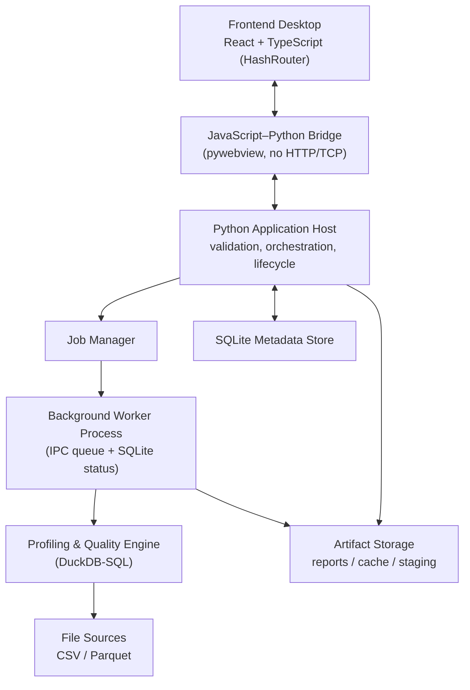

# Architecture & Architecture Decision Records

> [!NOTE] Relationship to other docs
> This document defines **system structure and the decisions behind it**. It resolves conflicts C1–C4 (see [[BLUEPRINT]] §4). Interfaces between components are specified in [[CONTRACTS]]; computational behavior in [[ENGINE_SPEC]].

## 1. Architecture style

**Modular monolith** — one Python backend, clearly separated internal modules, no microservices, no embedded HTTP server. The modules communicate through direct function calls and the in-process contracts; heavy computation runs in a separate OS process (worker) for isolation, not for service decomposition.

The frontend (React) is a thin presentation layer. Python owns all analytics and application logic.

## 2. System layers



### 2.1 Component responsibilities

| Component | Responsibility | Not responsible for |
|---|---|---|
| Frontend | User input, dashboard, tables, charts | Business rules, statistics computation |
| Bridge | Command/response/event transport between JS↔Python | Being a general-purpose Python RPC surface (locked facade only) |
| Application Host | Request validation, orchestration, app lifecycle | Running heavy analysis on the UI thread |
| Job Manager | Job id, status, progress, cancel, timeout, recovery | Data processing |
| Worker Process | Heavy profiling & quality execution | Owning UI state |
| Profiling & Quality Engine | Metrics, distributions, checks, findings, recommendations | Presentation, persistence policy |
| SQLite Metadata Store | Registry, runs, jobs, config versions, findings metadata | Storing large blobs |
| Artifact Storage | Reports, exports, staging, cache | Metadata queries |

## 3. Module boundaries (backend package layout)

```text
data_profiling_engine/
├── connectors/          # CSV, Parquet readers → DuckDB relations (MVP: no Excel/SQL)
├── discovery/           # schema inference, semantic types, dataset metadata
├── engine/              # metric registry + profilers (see ENGINE_SPEC)
│   ├── metrics/         # statistical, categorical, missingness, uniqueness, distribution, temporal
│   └── planner.py       # execution planner: exact / approximate / sampled decision
├── quality/             # rule registry, rule compiler (→ DuckDB SQL), executor, assessment
├── findings/            # detectors, deduplication, prioritization, fingerprinting
├── recommendations/     # rule-based templates, narrative assembly
├── orchestration/       # execution plan, job manager, runner, worker entrypoint
├── storage/             # metadata_store (SQLite), artifact_store, migrations
├── reporting/           # visualizations, HTML report (inline Plotly), JSON writer, CSV export
├── bridge/              # pywebview facade, command handlers, DTO validation (pydantic)
├── schemas/             # canonical JSON schemas for all contracts (single source of truth)
├── cli/                 # profiler-cli (internal Phase-1 harness)
└── tests/
```

> [!IMPORTANT] No `api/` HTTP module
> The reference architecture listed an optional `api/` (FastAPI) directory. Per **ADR-005 / conflict C3**, there is **no HTTP/TCP application server**. Integration happens through the bridge facade only. Do not create a `FastAPI` app "for convenience" in dev mode.

## 4. Data flow (single run)

```mermaid
sequenceDiagram
    participant U as Analyst (UI)
    participant B as Bridge
    participant H as Application Host
    participant J as Job Manager
    participant W as Worker
    participant E as Engine (DuckDB)
    participant S as SQLite + Artifact Store

    U->>B: profile.start(dataset_id, mode)
    B->>H: validated command
    H->>J: create job (QUEUED)
    J->>W: spawn worker with job payload
    W->>E: open source read-only; plan; run profilers + rules
    E-->>W: ColumnProfiles, QualityCheckResults
    W->W: build Findings + Recommendations
    W-->>J: progress events (steps completed)
    W->>S: persist result JSON, artifacts, run metadata
    W-->>J: SUCCEEDED
    H-->>B: status + result references
    B-->>U: report + visualizations + assessment
```

## 5. Architectural Decision Records

Each ADR: Context → Decision → Alternatives → Consequences → Validation. Statuses: **Accepted** (binding) / **Proposed** (needs spike).

### ADR-001 — Target macOS and Windows — Accepted
- **Context:** analysts use both OS.
- **Decision:** both are official targets; native build per OS.
- **Consequences:** cross-OS WebView testing; separate installer pipelines; `multiprocessing` spawn semantics on both.
- **Validation:** Phase-0 spike installs and runs on each OS.

### ADR-002 — Local desktop installer distribution — Accepted
- **Decision:** ship installers; runtime bundled; no cloud data egress.
- **Consequences:** packaging complexity; see [[SECURITY_PACKAGING]].

### ADR-003 — pywebview as desktop host — Accepted
- **Decision:** pywebview provides window + WebView + JS–Python bridge.
- **Alternatives rejected:** Electron (size/duplication), Tauri (Rust backend, breaks "Python is the center"), pure local web app (violates ADR-005).
- **Consequences:** WebView engine differs per OS (WKWebView / WebView2); bridge is request/response, so **progress is polled** (see CONTRACTS §5.5).
- **Validation:** bridge round-trip proven in packaged build.

### ADR-004 — React + TypeScript frontend — Accepted
- **Decision:** React + TS for rich UI; presentation only.
- **Consequences:** typed DTOs mirroring [[CONTRACTS]]; build to static local assets.

### ADR-005 — JS–Python bridge, no internal HTTP/TCP — Accepted (WAS conflict C3)
- **Context:** reference architecture allowed optional FastAPI; the evaluation doc forbade internal HTTP/TCP.
- **Decision:** **No local REST API, no FastAPI server, no TCP socket, no localhost HTTP polling — in development or production.** The pywebview bridge is the only internal UI↔backend channel. Remote DB/warehouse network protocols are still allowed (they are external data sources, not internal channels).
- **Alternatives rejected:** embedded FastAPI + HTTP (attack surface, port conflicts, contradicts single-process model).
- **Consequences:** large payloads must not traverse the bridge as one object; progress uses polling + push-via-evaluate_js.
- **Validation:** automated check that no listener binds a port at runtime; static rule in AGENTS.md.

### ADR-006 — Separate worker process for heavy analytics — Accepted
- **Decision:** profiling/quality jobs run in a `multiprocessing` child process, not a thread.
- **Alternatives rejected:** threads (no memory isolation, unsafe force-cancel, GIL contention with DuckDB).
- **Consequences:** payload must be picklable; spawn start-method on macOS+Windows; crash isolation and forceful termination are available; IPC via queue + SQLite status.
- **Validation:** worker crash test does not corrupt metadata store; force-cancel test.

### ADR-007 — DuckDB as primary file-analytics engine — Accepted
- **Decision:** DuckDB is the compute engine for CSV/Parquet; aggregation via SQL, not by loading full data into Python memory.
- **Consequences:** metric implementations are SQL expressions/templates; supports external-table spilling for >RAM data.
- **Validation:** benchmark at 10M/100M rows without full RAM load (see [[TESTING_BENCHMARKS]]).

### ADR-008 — SQLite for metadata persistence — Accepted
- **Decision:** SQLite stores dataset registry, runs, jobs, config versions, findings metadata, artifact references. Large results live in the artifact store as files, referenced by rows.
- **Consequences:** migration mechanism required; single-writer discipline (worker writes via short transactions).
- **Validation:** migration tests; concurrent read during run.

### ADR-009 — PyInstaller for packaging — Proposed (validate in Phase 0)
- **Decision:** PyInstaller is the initial packaging candidate; validate in Phase-0 spike before committing.
- **Risks:** native lib collection (DuckDB `.dylib`/`.dll`), pywebview js assets, startup time, antivirus false positives, macOS signing/notarization.
- **Fallback:** if PyInstaller fails on either OS, alternatives (cx_Freeze, Nuitka, or a bundled-venv + app-bundle approach) are re-evaluated via a superseding ADR.
- **Validation:** packaged app launches and completes a job on each OS.

### ADR-010 — Local frontend assets in production — Accepted
- **Decision:** production loads built React assets from local files; no dev server.
- **Consequences:** depends on ADR-013 routing; asset paths must resolve under `file://`.

### ADR-011 — MVP connectors: CSV + Parquet only — Accepted (WAS conflict C1)
- **Context:** reference docs disagreed on whether Excel/SQL belong in MVP.
- **Decision:** **MVP supports only CSV and Parquet.** Excel and the first SQL warehouse (default PostgreSQL, see BLUEPRINT Q2) are Phase-2. API sources are out of the current roadmap.
- **Rationale:** DuckDB reads CSV/Parquet natively and at scale; Excel needs the `spatial`/`calamine` path and loses type fidelity; a SQL connector adds auth/pushdown complexity that would delay proving the core engine. Narrow MVP prevents scope bleed.
- **Consequences:** connector interface must still be designed as pluggable so Phase-2 adds without contract change.
- **Validation:** MVP acceptance loads both a CSV and a Parquet fixture; no Excel code path is reachable in MVP.

### ADR-012 — Own DuckDB-SQL engine; no YData / Great Expectations / Soda — Accepted (WAS conflict C2)
- **Context:** reference architecture recommended adopting YData Profiling + GX/Soda; the evaluation doc's DuckDB stack implied a home-grown engine.
- **Decision:** **Build the profiler and quality engine in-house on DuckDB SQL** (metric registry + rule compiler, see [[ENGINE_SPEC]]). Do **not** depend on YData Profiling, Great Expectations, or Soda.
- **Rationale:** YData is Pandas-in-RAM and structurally incompatible with the "1–100M rows without full load" principle and with our JSON result contract; GX/Soda bring heavyweight runtime (contexts, datasources, checkpoints) that we would re-shell into our own contracts anyway. Our rule set is small and compiles directly to DuckDB SQL.
- **Alternatives considered:** (a) YData for quick profiles only — rejected for dependency/pandastic inconsistency; (b) GX as rule engine — rejected for integration cost; retained **GX-style YAML** as the shape of our rule config (documentation familiarity, no code dependency).
- **Consequences:** we own correctness of statistics → strong reference-testing obligation ([[TESTING_BENCHMARKS]] §3.1). We gain full control over exact/approx/sampled provenance and memory behavior.
- **Validation:** every engine metric passes tests against a reference computation (Polars/SQL/manual) on known fixtures.

### ADR-013 — HashRouter mandated for the SPA — Accepted (part of conflict C3)
- **Context:** production loads over `file://` (ADR-010) with no local HTTP server (ADR-005), so BrowserRouter history/paths break.
- **Decision:** the React app **must use `HashRouter`** (or equivalent hash/memory routing) exclusively. No browser-history routing.
- **Consequences:** URLs use `#/route`; deep links are hash-based; simpler `file://` asset resolution.
- **Validation:** all routes resolve when served from local files with no server; test in packaged build.

### ADR-014 — Single consolidated 6-doc pack — Accepted (WAS conflict C4)
- **Context:** earlier plans proposed 15 or 11 documents.
- **Decision:** maintain exactly **6 living documents + AGENTS.md**: [[BLUEPRINT]], [[ARCHITECTURE_AND_ADRS]], [[CONTRACTS]], [[ENGINE_SPEC]], [[SECURITY_PACKAGING]], [[TESTING_BENCHMARKS]], and `AGENTS.md`. The four files under `references/` are **frozen inputs**, not maintained specs.
- **Rationale:** fewer docs = fewer contradictions; each contract object has one source of truth; cross-reference, never restate.
- **Consequences:** when a topic would span docs, the owning doc is named here (contracts → [[CONTRACTS]], compute → [[ENGINE_SPEC]]).
- **Validation:** no duplicate definition of a schema/decision across the pack (lint/spot-check).

### ADR-015 — Metric provenance: exact / approximate / sampled / not_computed — Accepted
- **Decision:** every metric and check result carries a `method` field and `method_params` (including **sample seed** when sampled). No result may claim exactness it did not compute.
- **Consequences:** affects contracts, engine planner, report labeling, and baseline comparison (a method change is not a data-quality change).
- **Validation:** contract tests; report shows a method badge per metric.

### ADR-016 — Deterministic Finding fingerprint — Accepted
- **Decision:** every `Finding` carries a deterministic `fingerprint` derived from stable identity inputs (dimension + column/scope + rule/metric id), not from the changing numeric value. Enables cross-run identity, dedup, and drift/baseline features.
- **Consequences:** fingerprint algorithm belongs to `findings/fingerprinting.py`; baseline feature depends on it.
- **Validation:** same issue across two runs with different numbers → same fingerprint; different issue → different fingerprint.

### ADR-017 — Sentinel value sets are dataset-config input — Accepted (supersedes an implicit gap in ADR-015-era contracts)
- **Context:** `ColumnProfile.missingness.sentinel_count` (CONTRACTS §3.2) requires knowing which placeholder values ("N/A", "-", …) count as missing, but neither the frozen §9 config schema nor ENGINE §3 ever defined **where that set comes from**. The metric-registry comment (M2-T3) assumed "config input"; the field did not exist. Sentinel semantics are per-dataset business knowledge, and AGENTS §5 forbids hard-coding per-dataset behavior in code.
- **Decision:** the sentinel set is declared in dataset config as `profiling.missing.sentinel_values` (optional array of non-empty, unique strings; empty/absent ⇒ no sentinels, `sentinel_count` = 0). Matching is **exact, case-sensitive, on the raw stringified value** (NULL never matches) — normalization variants are explicitly rejected to keep behavior predictable and metadata-driven.
- **Consequences:** additive change to `dataset_config.schema.json` + `DatasetConfig` pydantic mirror + CONTRACTS §9 exemplar (all in the M2-T4 change); the missingness profiler passes the set as bound parameters (values never interpolated into SQL). No change to any persisted result contract.
- **Validation:** config with unknown keys still rejected before profiling; sentinel counts verified against hand-computed fixtures; absent config ⇒ `sentinel_count` == 0.

### ADR-018 — Report/narrative language: English labels + Indonesian narrative, config-switchable — Accepted (ratifies BLUEPRINT Q1 default; M4-T4)
- **Context:** BLUEPRINT Q1 left the report/UI language open with a documented default ("English metric labels + Indonesian narrative templates, switchable via config"), to be decided by M4. The recommendation layer (`recommendations/templates.py`) had shipped English-only narrative; nothing defined where the language switch lives or how it interacts with the frozen contracts.
- **Decision:** (1) **metric labels stay English** everywhere (already true of the M4-T2/T3 HTML/CSV writers); (2) the **recommendation narrative** (action / rationale / target_improvement / do_not / probe) ships **bilingual EN + ID**; (3) the switch is a new **optional top-level `DatasetConfig.language` ∈ {en, id}**, and the **shipped default is `en`**.
- **Consequences:** additive change to `dataset_config.schema.json` + the `DatasetConfig` pydantic mirror + `contracts.ts` (parity). `language` is Optional and **omitted-when-unset**, so a config that never mentions it round-trips byte-identically and `config_hash` / the golden fixture are unchanged — `id` is strictly opt-in. **The `Recommendation` contract shape (§4.3) does not change** — only the human-readable strings differ; ids, `evidence_refs`, `reason_type`, `status` and the findings/recommendations separation are language-independent. An unsupported language is a hard error, never a silent English fallback. No full i18n framework is introduced (YAGNI; MVP surface is two languages).
- **Validation:** `en` output stays byte-identical to golden; `id` recommendations validate against the unchanged `recommendation.schema.json`; identity/evidence/`reason_type` are equal across languages for the same finding (only strings differ); the §9 doc exemplar (no `language` key) still round-trips.

## 6. Decision summary matrix

| Aspect | Decision | ADR |
|---|---|---|
| App architecture | Modular monolith, worker process | ADR-006 |
| Result format | JSON master contract; HTML/PDF presentation | [[CONTRACTS]] |
| Quality score | Per-dimension, transparent weights; no single opaque score | [[ENGINE_SPEC]] §5.4 |
| Execution | Full / approximate / sampled, provenance-labeled | ADR-015 |
| Connectors (MVP) | **CSV + Parquet only** | ADR-011 |
| Profiling/quality engine | **Own DuckDB-SQL engine, no YData/GX/Soda** | ADR-012 |
| Internal transport | **Bridge only, no HTTP/TCP** | ADR-005 |
| Frontend routing | **HashRouter** | ADR-013 |
| Doc pack | **6 docs + AGENTS.md** | ADR-014 |
| Missingness sentinel set | **Dataset-config input (`profiling.missing.sentinel_values`)** | ADR-017 |
| Report/narrative language | **English labels + Indonesian narrative, `DatasetConfig.language` (default en)** | ADR-018 |
| Persistence | SQLite metadata + file artifact store | ADR-008 |
| Packaging | PyInstaller (pending Phase-0) | ADR-009 |
| Security | Read-only default, locked bridge, native credential store | [[SECURITY_PACKAGING]] |
| Reproducibility | Engine version + config version + seed + snapshot recorded | ADR-015 |
