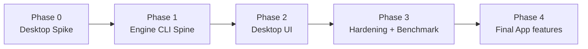

# Implementation Blueprint — Data Profiling Engine

> [!IMPORTANT] Source of truth
> This document is the master reference for building the Data Profiling Engine. It consolidates the four reference documents in `references/` into a single, contradiction-free pack of 6 documents + `AGENTS.md`. Where this pack and the raw reference notes disagree, **this pack wins** — the disagreements are resolved explicitly in §4 (Locked Decisions) and [[ARCHITECTURE_AND_ADRS]].

## 1. Product definition

**Data Profiling & Quality Assessment Engine** — a local desktop application (macOS + Windows) that accepts datasets, runs systematic profiling and quality checks, and produces explainable, evidence-traceable output.

Core pipeline (the product's spine):

```text
Ingest → Inspect → Profile → Validate → Detect Findings → Recommend → Store Results → Generate Outputs
```

Outputs per run:

1. **Data Profiling Report** — structure, characteristics, statistics, distributions.
2. **Visualizations** — distribution, missingness, relation, time-pattern charts.
3. **Data Quality Assessment** — PASS / FAIL / WARN / ERROR per rule, with evidence.
4. **Key Findings** — interpretive findings linked to metrics and rules.
5. **Recommendations** — suggested actions that never claim unproven causes.

What differentiates this product from generic profilers: the **Findings + Recommendations + Evidence traceability + Reproducibility** layers, not raw statistics. See [[ENGINE_SPEC]] §6–7 and [[CONTRACTS]] §4.

Design principles (inherited, unchanged):

- Modular, **metadata-driven** engine — behavior controlled by configuration, never per-dataset hard-coded functions.
- Strict separation of *measuring* (profiling), *judging* (quality rules), *interpreting* (findings), *acting* (recommendations).
- Structured JSON is the master result contract; HTML/PDF are presentations of it.
- Every finding traces to a metric, rule, or evidence reference.
- Every run is auditable and reproducible: `run_id`, config version, engine version, sampling method **and seed**.
- Read-only against data sources by default; no silent auto-remediation.
- Facts vs. interpretation vs. hypothesis are never mixed silently (see [[CONTRACTS]] §7 epistemics).

## 2. Document map

| Document | Contains | Read when |
|---|---|---|
| `BLUEPRINT.md` (this file) | Scope, locked decisions, build order, milestones, success criteria | Starting any work |
| [[ARCHITECTURE_AND_ADRS]] | System layers, module boundaries, all ADRs incl. conflict resolutions | Designing or changing any component |
| [[CONTRACTS]] | Domain models, result schemas, bridge protocol, job lifecycle, error codes | Writing code that crosses a module boundary |
| [[ENGINE_SPEC]] | Metric registry, profilers, rule catalog, findings/recommendation logic, modes | Implementing the engine |
| [[SECURITY_PACKAGING]] | Bridge hardening, credentials, masking, directory layout, installer | Packaging, distribution, security work |
| [[TESTING_BENCHMARKS]] | Test strategy, benchmark harness, acceptance criteria | Any "done" claim |
| `../AGENTS.md` (repo root) | Working rules for the coding agent | Every implementation session |
| `../STATE.md` (repo root) | **Working memory** — task-level breakdown of M0–M7, current position, gotchas. Not a spec (ADR-014 counts 6 spec docs; STATE.md is a status log) | Read first, update last, every session |

## 3. MVP vs Final App boundary

### 3.1 MVP — one dataset, end-to-end

In scope:

- **Connectors: CSV and Parquet files only** (Locked Decision C1, see §4).
- Schema detection; physical vs. logical type distinction.
- Core metrics: statistics, distributions, missingness, uniqueness.
- Basic quality rules from the rule catalog ([[ENGINE_SPEC]] §5).
- Rule-based findings with evidence; early recommendations.
- Basic auto-generated visualizations (histogram, frequency chart, missing-value chart, outlier summary).
- Exports: **HTML report, JSON results, CSV issue log**.
- Run metadata: `run_id`, config version, status, duration, error log, sampling flags + seed.
- Exact / approximate / sampled labeling on every metric (Locked Decision, [[CONTRACTS]] §3).

Out of scope for MVP (deliberately excluded — do not add):

- Excel, SQL/warehouse connectors (Phase 2), API sources.
- Cross-table relations, baseline/drift, rule builder UI, quality scorecard, scheduling, run history UI, AI/LLM summaries, issue-management workflow.
- FastAPI or any HTTP/TCP internal server (ADR-005).

MVP acceptance = [[TESTING_BENCHMARKS]] §5.1 checklist passing.

### 3.2 Final App — additive, contract-stable

The Final App extends configuration, inter-dataset relations, baseline & drift analysis, interactive exploration, per-dimension quality scores, prioritized findings with owner/status workflow, run history, and evidence-grounded AI assistance — **without changing the base result contracts**. Phase-2 connectors: Excel (Polars/calamine path) and one priority SQL database (PostgreSQL) with pushdown.

## 4. Locked decisions (conflict resolutions)

These resolve the four cross-document conflicts found during review. They are ADRs; deviation requires a superseding ADR, not a code change.

| ID | Conflict | Locked decision | ADR |
|---|---|---|---|
| **C1** | MVP connectors: Architecture said CSV+Excel+Parquet+SQL; Evaluation said CSV+Parquet | **CSV + Parquet only for MVP.** Excel and PostgreSQL move to Phase 2. Rationale: DuckDB reads both natively; Excel needs extensions and loses type fidelity | ADR-011 |
| **C2** | Library strategy: Architecture recommended YData + Great Expectations/Soda; Evaluation implied own DuckDB engine | **Own DuckDB-SQL engine. No YData, no Great Expectations, no Soda dependency.** Metric registry + rule compiler built in-house; GX-style YAML kept only as rule-syntax inspiration | ADR-012 |
| **C3** | FastAPI "bila diperlukan" vs. no-HTTP/TCP rule | **No HTTP/TCP server of any kind inside the app, including development mode. HashRouter is mandated** for the React SPA over `file://` assets | ADR-005, ADR-013 |
| **C4** | 15-doc vs. 11-doc documentation plans | **Single consolidated 6-doc pack + AGENTS.md** (this structure). Reference docs in `references/` are frozen inputs, not maintained specs | ADR-014 |

Two additional contract-level locks (from review R2/R6):

- Every metric and check result carries `method: exact | approximate | sampled | not_computed` plus `method_params` including **sample seed when sampled**.
- Every `Finding` carries a deterministic `fingerprint` for cross-run identity (see [[CONTRACTS]] §4.4).

## 5. Build order — risk-first spine

The implementation is ordered so that the highest technical risks (packaging, IPC, engine scalability) are proven before the UI is committed to them.



### Phase 0 — Desktop Spike (de-risk ADR-003/009/010)

- pywebview + React/HashRouter + PyInstaller hello-world **built and run on both macOS and Windows native environments**.
- Bridge round-trip (command, response, progress event via polling) proven in the packaged build, not dev mode.
- multiprocessing worker spawned on Windows (spawn semantics) with IPC queue + SQLite status, proven in packaged build.
- **Gate:** installers on both OS launch, show UI from local assets, complete a bridge call to a worker job. If the gate fails, revise ADRs before writing engine code — do not proceed.

### Phase 1 — Engine CLI Spine (the product's core)

- `profiler-cli` (internal, not shipped separately): `profile --input file.csv --config x.yaml --mode standard --out results/`.
- Connectors (CSV, Parquet) → DuckDB; schema/semantic-type inference.
- Metric registry + profilers per [[ENGINE_SPEC]] §3–4; rule compiler + quality executor §5.
- Findings + recommendation engines §6–7; domain contracts [[CONTRACTS]] §3–4.
- JSON result writer, HTML report + Plotly charts (inline, offline-shareable), CSV issue export.
- SQLite run-metadata writer.
- **Gate:** `sales_deals`-style fixture dataset produces a full contract-valid result set at 1M rows; correctness tests vs. reference computations pass.

### Phase 2 — Desktop UI

- Job manager + worker orchestration wrapped behind the bridge facade.
- React screens (MVP set): Dataset Selection, Run Configuration, Run Progress, Report View (Dataset Overview / Column Profiling / Visualizations / Quality Assessment / Findings & Recommendations), Export.
- Pagination-safe data transport: previews and charts receive aggregates/pages, never raw bulk arrays (payload limits in [[CONTRACTS]] §5.4).

### Phase 3 — Hardening & Benchmark

- 10M–100M-row benchmark runs, memory ceilings, cancellation latency, crash recovery.
- Both-OS installer matrix, upgrade/migration tests, security-contract tests. See [[TESTING_BENCHMARKS]].

### Phase 4 — Final App features (post-MVP, additive)

Run history, baseline/drift (using fingerprints), Phase-2 connectors (Excel, PostgreSQL+pushdown), quality scorecard per dimension, rule builder, interactive explorer depth, workflow features.

## 6. Milestone dependency graph

```text
M0 Spike            → blocks everything (packaging/bridge viability)
M1 Contracts freeze → engine, storage, UI all code against schemas
M2 Engine CLI       → needs M1; produces results without any UI
M3 Persistence      → needs M1; SQLite schema + artifact store
M4 Report generator → needs M2+M3 outputs
M5 Bridge facade    → needs M0; wraps M2–M4 behind commands
M6 UI screens       → needs M5
M7 Benchmark/hardening → needs M6 (and independently M2 for engine-only runs)
```

**Rule:** no milestone starts before its dependency's acceptance criteria pass. Milestones map to implementation tasks in [[TESTING_BENCHMARKS]] acceptance sections.

## 7. Definition of success

- **Product:** an analyst can load a CSV/Parquet, run profiling, read trustworthy findings backed by traceable evidence, and export HTML/JSON/CSV — on both macOS and Windows from an installer.
- **Engineering:** results are reproducible (engine version + config + seed recorded); sampled metrics are labeled; `FAIL ≠ ERROR` semantics hold; the source is never modified; UI stays responsive during 100M-row jobs.
- **Anti-goals (never optimize for these):** number of charts, a single opaque quality score, AI narrative without evidence, auto-"fixing" data.

## 8. Open questions (non-blocking, decide before the relevant milestone)

| # | Question | Decide by | Default if undecided |
|---|---|---|---|
| Q1 | Report/UI language: Indonesian, English, or i18n-first? | M4 (report generator) | **ACCEPTED 2026-10-25 → ADR-018.** English metric labels + Indonesian narrative templates, switchable via `DatasetConfig.language` ∈ {en, id}; shipped default **en** (backward-compatible; golden byte-identical) |
| Q2 | Phase-2 SQL priority connector | M6 / Phase 4 | PostgreSQL (duckdb `postgres_scanner` + pushdown) |
| Q3 | Is any LLM in the MVP? | M1 | **No.** AI is Phase 4 interpretation layer only |
| Q4 | Windows build machine / CI for the installer matrix | M0 | Local physical/virtual Windows machine required — not optional |
