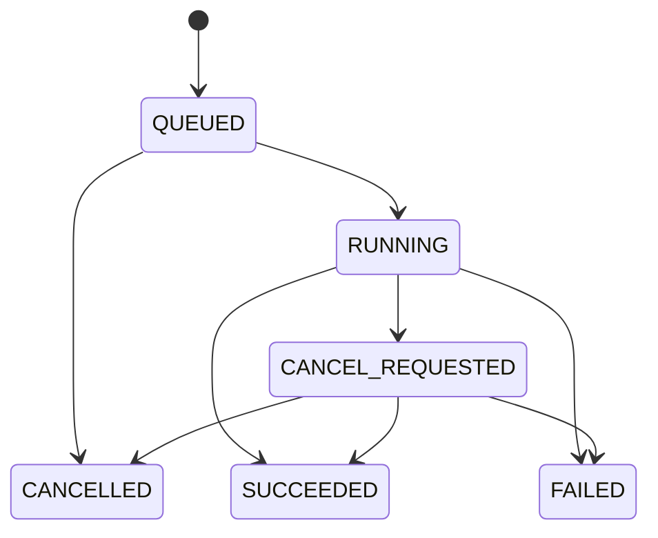

# Domain Models, Result Contracts, Bridge Protocol & Job Lifecycle

> [!IMPORTANT] Single source of truth for interfaces
> Every object that crosses a module, process, or language boundary is defined **here and only here** (ADR-014). Implement these as `pydantic` models in Python and mirror them as TypeScript types in React, both generated from / validated against the canonical JSON Schemas in `schemas/`. Computation rules live in [[ENGINE_SPEC]]; this document defines *shape*, not *how*.

## 1. Contract conventions

- **Format:** JSON is the master result contract. HTML/PDF/CSV are downstream presentations of the same objects.
- **Versioning:** every persisted object carries `schema_version` (semver, e.g. `"1.0"`). Additive changes bump minor; breaking changes bump major and require a migration note.
- **IDs:** globally unique within a run; `run_id`, `job_id`, `request_id` are ULIDs/UUIDv7 (time-sortable). Finding `fingerprint` is a stable content hash (§4.4).
- **Nulls:** absent metric value = `method: "not_computed"` with a `reason`, never a silent `null`.
- **Timestamps:** ISO-8601 UTC (`...Z`). Profilers preserve source timezone metadata separately (§3.2 temporal).
- **Provenance (ADR-015):** any computed numeric carries `method` ∈ `{exact, approximate, sampled, not_computed}` and `method_params`.

### 1.1 The `Provenance` block (embedded in every metric/check result)

```json
{
  "method": "sampled",
  "method_params": {
    "sampling_strategy": "reservoir",
    "sample_size": 100000,
    "population_size": 52000000,
    "seed": 20261024,
    "algorithm": "duckdb-approx_quantile",
    "confidence": 0.95
  },
  "computed_at": "2026-10-24T09:12:03Z",
  "engine_version": "0.1.0"
}
```

Rules:
- `method: "exact"` → `method_params` may be `{}`.
- `method: "sampled"` → `seed` is **required** (reproducibility lock in [[BLUEPRINT]] §4).
- `method: "approximate"` → `algorithm` required; a report must render a "≈" badge.
- `method: "not_computed"` → `reason` required (e.g. `"column_type_unsupported"`).

## 2. Run metadata — `ProfilingRun`

Every execution produces exactly one run record with at least:

```json
{
  "schema_version": "1.0",
  "run_id": "01J8Z4K2M7...",
  "job_id": "01J8Z4K...",
  "dataset": {
    "dataset_id": "ds_...",
    "source_kind": "file",
    "connector": "csv",
    "source_ref": "sales_deals.csv",
    "source_snapshot": { "path": "...", "size_bytes": 10485760, "modified_at": "...", "content_hash": "sha256:..." }
  },
  "config": { "config_version": "3", "config_hash": "sha256:...", "profile_mode": "standard" },
  "engine": { "engine_version": "0.1.0", "duckdb_version": "1.x", "python_version": "3.12.x" },
  "timing": { "started_at": "...", "finished_at": "...", "duration_ms": 182000 },
  "sampling": { "enabled": true, "strategy": "reservoir", "sample_size": 100000, "seed": 20261024 },
  "status": "SUCCEEDED",
  "result_refs": {
    "profile_json": "artifacts/DP-0001/profile.json",
    "html_report": "artifacts/DP-0001/report.html",
    "issue_csv": "artifacts/DP-0001/issues.csv"
  },
  "error_log": [ { "code": "RULE_EXEC_FAILED", "task": "deal_value_outlier_scan", "message": "..." } ],
  "warnings": []
}
```

- `source.content_hash` + `config_hash` + `engine_version` + `seed` together make the run reproducible/auditable.
- `status` uses the Job terminal states (§6.2): `SUCCEEDED`, `FAILED`, `CANCELLED`.
- Per-task errors are recorded without failing the whole run (§6.4).

## 3. Profiling objects

### 3.1 `DatasetProfile`

```json
{
  "schema_version": "1.0",
  "run_id": "...",
  "row_count": { "value": 20000, "provenance": { "method": "exact" } },
  "column_count": 8,
  "grain": "one_row_per_deal",
  "primary_key_candidates": ["deal_id"],
  "temporal_coverage": { "column": "created_at", "min": "...", "max": "...", "provenance": { "method": "exact" } },
  "source_metadata": { "connector": "csv", "delimiter": ",", "encoding": "utf-8" },
  "columns": [ /* ColumnProfile[] */ ]
}
```

### 3.2 `ColumnProfile`

Physical vs. logical type distinction is required (MVP checklist).

```json
{
  "schema_version": "1.0",
  "column": "deal_value",
  "ordinal": 5,
  "physical_type": "VARCHAR",
  "logical_type": "numeric_currency",
  "semantic_type": "measure",
  "unit": { "currency": "USD", "status": "assumed" },
  "missingness": { "null_count": 3000, "blank_count": 0, "sentinel_count": 0,
                   "missing_rate": { "value": 0.15, "denominator": 20000,
                   "provenance": { "method": "exact" } } },
  "uniqueness": { "distinct_count": { "value": 16820,
                   "provenance": { "method": "approximate",
                   "method_params": { "algorithm": "duckdb_count_distinct_hll" } } },
                   "is_unique_candidate": false },
  "stats": {
    "valid_count": 17000,
    "min": { "value": 0, "provenance": { "method": "exact" } },
    "max": { "value": 980000, "provenance": { "method": "exact" } },
    "mean": { "value": 18450, "provenance": { "method": "exact" } },
    "median": { "value": 6800, "provenance": { "method": "approximate",
               "method_params": { "algorithm": "duckdb_quantile_cont" } } },
    "p95": { "value": 82000, "provenance": { "method": "approximate",
            "method_params": { "algorithm": "duckdb_approx_quantile", "confidence": 0.95 } } },
    "stddev": { "value": 41200, "provenance": { "method": "exact" } }
  },
  "distribution": { "histogram": { "bins": [...], "counts": [...],
                     "provenance": { "method": "exact" } },
                     "skewness": { "value": 4.2, "provenance": { "method": "exact" } },
                     "outlier_candidates": { "count": 47, "method": "iqr_1_5",
                       "provenance": { "method": "exact" },
                       "sample_row_refs": ["row:..."] } },
  "categorical": null,
  "temporal": null,
  "visualization_refs": ["chart:deal_value_hist"],
  "related_metric_refs": ["metric:deal_value_missing_rate"]
}
```

Notes:
- `unit.status` ∈ `{known, assumed, unknown}` — a currency not confirmed by config is `assumed`/`unknown`, never silently asserted (MVP §3.2.1 requirement).
- `categorical` block (populated for categorical types): `categories`, `frequencies`, `rare_categories`, `label_inconsistencies`.
- `temporal` block (populated for datetime types): `range`, `volume_per_granularity`, `gaps`, `out_of_expected_range`, `timezone_source` (`naive|utc|offset:+7`).
- `sample_row_refs` are references, not raw values, so sensitive data is only included after masking rules ([[SECURITY_PACKAGING]] §4).

## 4. Quality, findings, recommendations

### 4.1 `QualityCheckResult`

```json
{
  "schema_version": "1.0",
  "run_id": "...",
  "rule_id": "deal_value_missing_rate",
  "rule_version": "1",
  "dimension": "completeness",
  "status": "FAIL",
  "severity": "high",
  "column": "deal_value",
  "observed": { "value": 0.15, "provenance": { "method": "exact" } },
  "threshold": { "operator": "<=", "value": 0.05 },
  "failing_record_count": 3000,
  "evidence": { "denominator": 20000, "sample_row_refs": ["row:..."], "baseline_ref": null },
  "error": null,
  "executed_at": "..."
}
```

Status semantics (MVP lock, never conflate FAIL and ERROR):
- `PASS` — check ran successfully; rule satisfied.
- `FAIL` — check ran successfully; data violated the rule.
- `WARN` — check ran; condition warrants review, not absolute failure.
- `ERROR` — check could not be completed (type mismatch, unreadable source, etc.). Engine has **not** proven whether the rule holds.

`dimension` (ADR-derived, required for scorecard) ∈ `completeness | uniqueness | validity | consistency | timeliness | accuracy_flagged`. `accuracy` is deliberately **not** auto-scored from validity — see [[ENGINE_SPEC]] §5.4.

### 4.2 `Finding`

```json
{
  "schema_version": "1.0",
  "finding_id": "F-001",
  "fingerprint": "sha256:...",
  "run_id": "...",
  "title": "Deal value incomplete",
  "summary": "15% of deal_value is empty, above the 5% configured threshold.",
  "category": "completeness",
  "severity": "high",
  "confidence": "high",
  "scope": { "column": "deal_value", "affected_records": 3000, "period": null },
  "facts": [ { "metric_ref": "metric:deal_value_missing_rate", "value": 0.15,
               "provenance": { "method": "exact" } } ],
  "interpretation": "Revenue and segment comparisons may be biased if analyzed as-is.",
  "hypotheses": [ { "text": "Missingness may cluster by status/source/period",
                    "status": "unverified", "suggested_probe": "group missing rate by status" } ],
  "evidence_refs": ["metric:deal_value_missing_rate", "rule:deal_value_missing_rate"],
  "related_finding_ids": [],
  "recommendation_ids": ["R-001"],
  "workflow": null
}
```

- `facts` / `interpretation` / `hypotheses` are **structurally separated** (§7). A finding may not place an unverified cause in `facts`.
- MVP leaves `workflow` = `null` (owner/status/resolution are Final App, §4.5).

### 4.3 `Recommendation`

```json
{
  "schema_version": "1.0",
  "recommendation_id": "R-001",
  "finding_id": "F-001",
  "action": "Investigate deal_value completeness from the CRM source and sync mechanism.",
  "rationale": "Missing rate exceeds configured threshold and can bias revenue analysis.",
  "reason_type": "evidence",
  "target_improvement": "Reduce unexplained missingness below threshold or document cause.",
  "do_not": ["Do not fill empty values with zero as a first response."],
  "evidence_refs": ["metric:deal_value_missing_rate"],
  "status": "proposed"
}
```

- `reason_type` ∈ `evidence | heuristic | business_context_required`. Recommendations **must** reference evidence; if none exists, mark `business_context_required` and phrase as an investigation question, never a proven cause.

### 4.4 Finding fingerprint algorithm (ADR-016)

`fingerprint = sha256( category | scope_key | detector_id | normalized_measure )`
where:
- `scope_key` = `dataset_id + (table?) + column` (the stable location of the issue).
- `normalized_measure` = the metric/rule identity, **not** its value (e.g. `missing_rate`), so the value may change across runs while identity is stable.
- Purpose: enable cross-run matching, dedup, and baseline/drift identity in Final App. Two runs with the same problem but different numbers → same fingerprint.

### 4.5 `FindingWorkflow` (Final App schema, defined now for contract stability)

```json
{ "owner": null, "status": "open|acknowledged|investigating|resolved|accepted_risk",
  "comments": [], "resolution_evidence": null, "updated_at": null }
```

MVP always emits `workflow: null`; the field exists so Final App adds behavior without a breaking contract change.

## 5. Bridge protocol (JS ↔ Python)

### 5.1 Facade model

The bridge exposes a **fixed, allow-listed command facade** — never arbitrary Python, `eval`, or filesystem access. Commands are validated against schemas before dispatch. See [[SECURITY_PACKAGING]] §3.

### 5.2 Command set (MVP)

| Command | Purpose | Response type |
|---|---|---|
| `dataset.inspect` | Read schema/types/size metadata | sync result |
| `dataset.preview` | Paginated preview (bounded rows) | sync result |
| `profile.start` | Enqueue a profiling job | accepted + `job_id` |
| `profile.get_status` | Poll job status/progress | status object |
| `profile.cancel` | Request cancellation | accepted |
| `quality.get_results` | Fetch quality check results (paged) | result set |
| `findings.get` | Fetch findings (paged) | result set |
| `recommendations.get` | Fetch recommendations (paged) | result set |
| `report.get_summary` | Fetch run summary | summary object |
| `report.get_columns` | Fetch §3.2 column profiles (paged) | result set |
| `artifact.open` | Open/export an allow-listed artifact | ack |

> [!NOTE] `report.get_columns` (ADR-019) — the §3.2 **column-body** read
> `report.get_summary` is counts-only (§3.1); the per-column metric bodies
> (`missingness`, `uniqueness`, `stats`, `distribution`, `categorical`, `temporal`)
> that the Report View's Schema & Column Profiling screen renders were not reachable
> by any earlier §5.2 command — they lived only in the `profile_json` artifact
> behind `artifact.open` (no bytes cross). `report.get_columns` closes that gap: it
> addresses one run the same way the other reads do (explicit `run_id`, else the
> dataset's latest run), reads the persisted §3.1 document, and pages `ColumnProfile`
> objects **by column ordinal** so each response stays under the §5.4 1 MiB cap
> (`limit` ≤ 200, default 50). Each page item is the unchanged §3.2 `ColumnProfile`
> (validated against `column_profile.schema.json`), carrying its own per-metric
> provenance (ADR-015) — the command adds no new metric and re-shapes nothing. Array
> bodies (histogram bins, category frequencies) are returned whole per column and
> page smaller when a wide/high-cardinality run would exceed the cap.

> [!NOTE] `recommendations.get` (ADR-020) — the §4.3 **recommendation-body** read
> A `Finding` (§4.2) cites its recommendations only by `recommendation_ids`; the
> §4.3 bodies (`action` / `rationale` / `do_not` / `reason_type` / evidence refs)
> were reachable by no earlier §5.2 command — `report.get_summary` is counts-only
> and the full bodies lived only in the `profile_json` artifact behind
> `artifact.open` (no bytes cross). `recommendations.get` closes that gap with the
> same ADR-019 pattern: addressed by `run_id` (else the dataset's latest run),
> optionally narrowed to a single `finding_id`, pages §4.3 `Recommendation`
> objects (`limit` ≤ 200, default 50) so each response stays under the §5.4 1 MiB
> cap. Each item is the unchanged §4.3 `Recommendation` (validated against
> `recommendation.schema.json`); the command adds no recommendation and re-shapes
> nothing, keeping the §7 fact/interpretation/recommendation separation intact.

### 5.3 Message envelopes

Request:
```json
{ "command": "profile.start", "request_id": "req-...", "payload": { "dataset_id": "ds_...", "profile_mode": "standard" } }
```
Accepted response:
```json
{ "request_id": "req-...", "status": "accepted", "job_id": "job_..." }
```
Status (polled):
```json
{ "job_id": "job_...", "status": "RUNNING",
  "progress": { "completed_steps": 3, "total_steps": 8, "current_step": "profiling:distributions" } }
```
Error:
```json
{ "request_id": "req-...", "status": "error",
  "error": { "code": "DATASET_READ_FAILED", "message": "Dataset could not be read.", "retryable": false } }
```

### 5.4 Payload rules (binding)

- Every request has a `request_id`; every long job has a `job_id`.
- Request/response and job events are schema-validated (pydantic ↔ TS types).
- **No large object crosses the bridge as one payload.** Limits: preview ≤ 200 rows; result fetch is paged; charts send aggregates/pages, never raw arrays. Cap per-message serialized size at **1 MiB** (tune via benchmark, [[TESTING_BENCHMARKS]] §4); exceeding it must use `artifact.open` or paging.
- All commands validate arguments **and** allowed-scope (path allow-list §[[SECURITY_PACKAGING]]).
- Error codes come from the registry (§8), consistent across bridge and job events.

### 5.5 Progress model

Because pywebview is request/response (ADR-003/005), progress is delivered by **polling `profile.get_status`** from the UI, with optional host→JS `evaluate_js` push events using the same status object shape. Both paths share one schema so the UI code is transport-agnostic.

Binding details of the push option (M5-T3, no new command or schema):

- The pushed body is exactly the §5.3 polled status object (`job_status.schema.json`), `job_id` included — a push carries no response envelope, so nothing may be dropped or added relative to the polled form. One serialiser serves both transports.
- The host delivers a push by evaluating a fixed expression that calls the optional global `window.__dpeJobStatus(status)`; the UI defines that callback to receive hints and may ignore it entirely. No caller-supplied text reaches the JS expression (SECURITY §3).
- Polling stays **authoritative**: a push is a hint, may be coalesced (newest status per job wins) or dropped (e.g. when it would exceed the §5.4 1 MiB cap), and a push failure never changes a job's state or surfaces as an error.

## 6. Job lifecycle

### 6.1 State machine



### 6.2 States

| State | Meaning | Terminal |
|---|---|---|
| `QUEUED` | Registered, worker not yet started | no |
| `RUNNING` | Worker executing plan | no |
| `CANCEL_REQUESTED` | Cancel asked; **not** a guarantee the work stopped | no |
| `SUCCEEDED` | Finished; results persisted | yes |
| `FAILED` | Unrecoverable error; partial results may exist | yes |
| `CANCELLED` | Confirmed stopped; partial artifacts marked | yes |

### 6.3 Job manager minimum features (binding)

Start, status, progress reporting, cancel, timeout, error reporting, worker crash detection, temp-artifact cleanup, persistence of critical state, recovery on app restart.

### 6.4 Partial-failure policy

A per-task failure (e.g. one profiler or rule raises) is recorded in `run.error_log` and the run continues other tasks. Only systemic failures (source unreadable, worker crash) move the job to `FAILED`. Successful sections are always preserved and surfaced — never hide a working report because one rule errored.

### 6.5 Cancellation & timeout semantics

- `profile.cancel` sets `CANCEL_REQUESTED`; worker checks a cancel flag at task/step boundaries and (for DuckDB) interrupts the active query. Job reaches `CANCELLED` only after confirmation.
- Timeout is configurable per mode; on timeout the job follows the cancel path and is finally marked `FAILED` with code `JOB_TIMEOUT` if it cannot stop cleanly.
- DuckDB is single-writer per connection; the worker owns its connection; the host never holds a write lock during a job.

## 7. Epistemic separation (cross-cutting rule)

Every output layer must classify each statement as one of:

| Class | Definition | Where allowed |
|---|---|---|
| **Fact** | Value computed by the engine, with provenance | `facts`, metrics |
| **Interpretation** | Possible meaning/impact if relevant to the analysis | `interpretation` |
| **Hypothesis** | Suspected cause requiring verification | `hypotheses` (marked unverified) |
| **Recommendation** | Suggested action with reason + evidence refs | `recommendation` |

No component may move a hypothesis up into facts or assert an unverified cause. AI/LLM (Final App only) must cite existing evidence and never invent numbers.

## 8. Error code registry (initial, extensible)

| Code | Layer | Meaning | Retryable |
|---|---|---|---|
| `CONFIG_INVALID` | host | Config failed schema validation | no |
| `DATASET_READ_FAILED` | connector | Source unreadable/missing | maybe |
| `SOURCE_NOT_ALLOWED` | security | Path/scope outside allow-list | no |
| `SCHEMA_INFERENCE_FAILED` | discovery | Could not infer types | no |
| `METRIC_NOT_COMPUTED` | engine | Metric unsupported for type | no |
| `RULE_EXEC_FAILED` | quality | Rule could not execute → status ERROR | maybe |
| `WORKER_CRASHED` | job | Worker process died | maybe |
| `JOB_TIMEOUT` | job | Exceeded mode timeout | no |
| `BRIDGE_PAYLOAD_TOO_LARGE` | bridge | Message exceeded cap | no |
| `BRIDGE_COMMAND_UNKNOWN` | bridge | Command not in allow-list | no |
| `ARTIFACT_WRITE_FAILED` | storage | Could not persist artifact | maybe |
| `METADATA_WRITE_FAILED` | storage | Could not persist a metadata-store row (SQLite) | maybe |
| `BRIDGE_REQUEST_INVALID` | bridge | Envelope/command-payload schema validation failed | no |
| `JOB_NOT_FOUND` | job | Status/cancel referenced an unknown job id | no |

Error objects must never contain credentials or raw sensitive data values ([[SECURITY_PACKAGING]] §5).

> The registry is formalised as a Python module in `data_profiling_engine/errors.py` (M1-T6): `ErrorCode` (one member per code) + `ERROR_REGISTRY` (code → layer/meaning/retryable) with `lookup`/`is_retryable`/`is_registered` helpers. `BRIDGE_REQUEST_INVALID` and `JOB_NOT_FOUND` were introduced by the M0-T2/M0-T3 spike and promoted here in M1-T6. `METADATA_WRITE_FAILED` was introduced by M3-T1 (SQLite metadata store) under this same rule. Add a new code by appending a row here **and** an `ErrorCode`/registry entry in the same change.

## 9. Dataset configuration schema (input contract)

YAML config, validated by a JSON Schema in `schemas/` before any profiling starts; invalid config is rejected with clear errors (design principle). Rule YAML is **GX-style in shape only** — there is no GX dependency (ADR-012).

```yaml
config_version: 3
language: en                 # optional (ADR-018 / BLUEPRINT Q1): en | id narrative
                             # templates; metric labels stay English; omitted => en
                             # (additive + omitted-when-unset, so config_hash is stable)
dataset:
  name: sales_deals
  grain: one_row_per_deal
  primary_key: [deal_id]
  units: { deal_value: { currency: USD, status: assumed } }
profiling:
  mode: standard            # quick | standard | deep
  sampling: { enabled: false, strategy: reservoir, size: 100000, seed: 20261024 }
  sections: [schema, descriptive_statistics, missing_values, uniqueness, distributions]
  missing: { sentinel_values: ["N/A", "n/a", "NA", "-", "unknown"] }
quality_checks:
  - id: deal_id_not_null
    rule: not_null
    column: deal_id
    dimension: completeness
    severity: critical
  - id: deal_id_unique
    rule: unique
    column: deal_id
    dimension: uniqueness
    severity: critical
  - id: deal_value_missing_rate
    rule: missing_rate_max
    column: deal_value
    value: 0.05
    dimension: completeness
    severity: high
  - id: revenue_non_negative
    rule: greater_than_or_equal
    column: deal_value
    value: 0
    dimension: validity
    severity: warning
    business_note: "negative may be valid for refunds; flagged for review, not auto-fail"
  - id: closed_won_has_closed_at
    rule: conditional_not_null
    column: closed_at
    condition: { column: status, operator: equals, value: "Closed Won" }
    dimension: completeness
    severity: high
```

- Each rule declares `dimension` (required for scorecard, [[ENGINE_SPEC]] §5.4).
- `business_note` supports semantics-aware handling (e.g. negative revenue valid for refunds).
- Unknown/unvalidatable config or rule keys are hard errors before execution.
- `profiling.missing.sentinel_values` (optional, ADR-017): the closed per-dataset set of sentinel placeholders counted by `ColumnProfile.missingness.sentinel_count`. Matching is **exact, case-sensitive, on the raw stringified value** (no trim, no folding — predictable metadata-driven behavior); NULL never matches. When absent, `sentinel_count` is 0. Sentinel values are business placeholders, not credentials/raw sensitive values (SECURITY §5).
