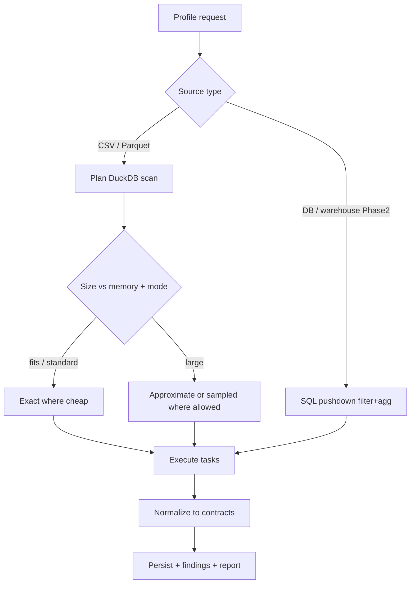

# Profiling & Quality Engine Specification

> [!IMPORTANT] Scope of this document
> Defines **what the engine computes and how it decides to compute it** (ADR-012: own DuckDB-SQL engine, no YData/GX/Soda). Output object shapes are in [[CONTRACTS]]; this document references them but does not redefine them. The engine is metadata-driven: behavior comes from the metric registry + dataset config, never per-dataset code.

## 1. Engine philosophy

- **One algorithm family, many datasets.** Adding a dataset means registering a source + config, not writing `profile_<domain>()` functions.
- **Measure ≠ judge ≠ interpret ≠ act.** Profilers measure; the quality engine judges against rules; the findings engine interprets; the recommendation engine proposes actions. Each is a separate module with its own tests.
- **DuckDB-first computation.** Metrics are SQL expressions/templates executed against relations (files or pushed-down queries). Data is only materialized in Python when a metric genuinely needs it, and then bounded (samples, aggregates, pages) — never a full `df` of 100M rows.
- **Provenance is mandatory.** Every emitted metric carries `method` + `method_params` ([[CONTRACTS]] §1.1).

## 2. Execution planner

The planner decides, per metric/task, **how** to compute given mode, source, size, and cost.



### 2.1 Cost classes

Each metric declares a cost class so the planner can decide automatically:

| Class | Examples | Default at large N |
|---|---|---|
| `cheap_exact` | count, null count, min/max, mean, sum, approx-free validity | exact always |
| `moderate_exact` | stddev, quantile_cont, frequency counts on low-cardinality | exact under standard; sketch under quick |
| `expensive_exact` | `COUNT(DISTINCT)` on high cardinality, full correlation matrix, FD discovery, duplicate grouping | approximate/sampled unless deep |
| `prohibited_at_scale` | loading full column into Pandas, O(n²) all-pairs on 1000s of columns | never full; sample/cap with labeling |

### 2.2 Approximation toolbox (DuckDB-native)

- Distinctness: `approx_count_distinct` (HLL) → `method: approximate`, algorithm recorded.
- Quantiles: `quantile_cont` (exact, costlier) vs `approx_quantile` (t-digest) chosen by mode/class.
- Sampling: **reservoir sampling** for representative subsets; block/segment sampling only when the metric needs locality — and the strategy + **seed** are always recorded (reproducibility lock, [[BLUEPRINT]] §4).
- Histograms: fixed bin count with `width_bucket`; bin strategy recorded in `method_params`.

> [!WARNING] Sampling honesty
> A sampled/approximate metric must never be presented as exact. The planner stamps `method`, and the report renders a badge. Changing the sampling method between runs is **not** a data-quality change — baseline comparison must account for method (see §8 and [[CONTRACTS]] provenance).

## 3. Profilers (MVP-active set)

Each profiler consumes a DuckDB relation and emits contract objects. Only relevant profilers run per column, chosen by logical/semantic type (see §4 selection).

| Profiler | Computes | MVP | Contract target |
|---|---|---|---|
| **Schema Profiler** | columns, physical types, logical/semantic types, key candidates | yes | DatasetProfile |
| **Statistical Profiler** | count, min/max, mean, median, quantiles, stddev, variance | yes | ColumnProfile.stats |
| **Categorical Profiler** | frequency, cardinality, rare categories, label inconsistency | yes | ColumnProfile.categorical |
| **Missingness Profiler** | null, blank, sentinel values, missing rate + denominator | yes | ColumnProfile.missingness |
| **Uniqueness Profiler** | distinctness, duplicate keys, uniqueness candidates | yes | ColumnProfile.uniqueness |
| **Distribution Profiler** | histogram, skewness, outlier candidates (IQR/percentile) | yes | ColumnProfile.distribution |
| **Temporal Profiler** | range, volume per granularity, gaps, out-of-range | partial (single-col) | ColumnProfile.temporal |
| **Pattern Profiler** | text/identifier format, category mismatch | partial | feeds semantic + findings |
| **Relationship Profiler** | correlation, association, functional dependency | Phase 2 (deep) | Final App |
| **Relational Profiler** | join cardinality, orphans, referential integrity | Phase 2 (deep, cross-table) | Final App |
| **Drift Profiler** | change vs baseline | Phase 4 | Final App |

> Sentinel values (Missingness Profiler) come from dataset config `profiling.missing.sentinel_values` (ADR-017); the set is closed per dataset, matched exact/case-sensitive, and an absent set means `sentinel_count` = 0. `missing_rate` denominator is the scanned relation's row count (sample or full, per the planner's method decision).

### 3.1 Correlation guardrail (why not MVP)

Numeric all-pairs correlation is O(n²) in columns and expensive in rows. It is intentionally excluded from MVP. When added (deep mode), the engine must support column selection, pair cap (e.g. top-K by relevance), sampling, and a computation budget — never brute-force on a wide dataset.

## 4. Profiler selection logic

The orchestrator selects profilers based on:

1. **Physical + logical type** (e.g. statistical metrics only for numeric logical types).
2. **Dataset config** (`profiling.sections`, explicit column include/exclude).
3. **Mode** (quick/standard/deep) gating cost class (§2.1).
4. **Metadata availability** (declared PK/grain enables uniqueness/key checks without guessing).
5. **Connector/backend capability** (pushdown availability for Phase-2 sources).
6. **Budget** (time/memory caps; exceeding a cap degrades to approximate/sampled with labeling, or skips with `not_computed` + reason).

### 4.1 Semantic type inference (logical ≠ physical)

Inference order, recorded with a confidence so misclassification is visible:

- Physical type from DuckDB read (VARCHAR/BIGINT/TIMESTAMP/...).
- Logical/semantic type from signals: value patterns (regex for email/phone/date/URL/id), cardinality ratio (distinct/rows → identifier vs categorical vs measure), name heuristics (`_id`, `_at`, `amount`), charset analysis.
- Currency/unit: only `known` if config or unambiguous symbol declares it; else `assumed`/`unknown` ([[CONTRACTS]] §3.2 `unit.status`).
- Inference never overwrites a user config declaration; config wins.

## 5. Quality Engine

### 5.1 Rule registry

A rule is a declarative definition: `id, type, params, column, dimension, severity, threshold, condition?, business_note?, version`. Types (MVP catalog):

| Rule type | Semantics | Dimension |
|---|---|---|
| `not_null` | column has no nulls (or rate below max) | completeness |
| `unique` | column values unique | uniqueness |
| `missing_rate_max` | missing rate ≤ threshold | completeness |
| `greater_than_or_equal` / `less_than_or_equal` / `range` | value bounds | validity |
| `valid_domain` | values ⊆ allowed set | validity |
| `type_valid` | parses as declared logical type | validity |
| `conditional_not_null` | not-null when condition column matches | completeness/consistency |
| `referential_integrity` | values exist in another table | consistency (Phase 2) |
| `date_order` | e.g. `closed_at ≥ created_at` | consistency (Phase 2/deep) |
| `outlier_scan` | candidates beyond method threshold | accuracy_flagged (→ WARN) |

### 5.2 Rule compiler (YAML → DuckDB SQL)

Each rule compiles to **one SQL statement** returning `(violations, total, sample_row_ids)` against a relation — no row-by-row Python, so 100M-row checks stay fast and memory-flat.

Example (`conditional_not_null`):
```sql
SELECT
  COUNT(*) FILTER (WHERE status = 'Closed Won' AND closed_at IS NULL) AS violations,
  COUNT(*) FILTER (WHERE status = 'Closed Won')                       AS total,
  COALESCE(array_agg(rowid) FILTER (WHERE status='Closed Won' AND closed_at IS NULL)
           [1:200], [])                                                AS sample_row_ids
FROM read_parquet(:path);
```
Example (`missing_rate_max` on `deal_value`):
```sql
SELECT COUNT(*) FILTER (WHERE deal_value IS NULL OR trim(deal_value::VARCHAR)='') AS violations,
       COUNT(*) AS total
FROM read_csv(:path);
```
- `sample_row_ids` capped (≤200) to respect [[CONTRACTS]] §5.4 payload limits; full lists go to artifacts via export.
- `rowid`/pseudo-id source is defined per connector (Parquet row group+offset; CSV generated line number) so evidence rows are reproducible with the same seed.

### 5.3 Rule execution & status

```text
compile → execute → if execution raises: status=ERROR (code RULE_EXEC_FAILED)
                   → else: violations/total vs threshold → PASS / FAIL / WARN
```
- `ERROR` is distinct from `FAIL` ([[CONTRACTS]] §4.1): the engine did not prove compliance.
- `WARN` rules (e.g. `outlier_scan`, `business_note`-flagged negatives) never hard-fail; they raise review candidates.
- Rules whose column/type is absent are recorded as `not_computed` with reason, not silently dropped.

### 5.4 Quality score policy

- MVP shows **counts per status** (PASS/FAIL/WARN/ERROR) and per-dimension rollups — not a single number.
- Final App may compute a **per-dimension score** with **declared weights** and visible rule-level evidence + denominator. Combined global score is opt-in and must expose the weight table.
- Hard rules: minor-rule passes must not mask a critical failure; a dimension score must always link to the rules beneath it.
- **Accuracy is never inferred from validity.** Passing type/range checks ≠ business-correct; accuracy needs an external comparison or verification mechanism, so it is surfaced as `accuracy_flagged`/WARN and investigation, not a score.

## 6. Findings Engine

Pipeline (from reference, unchanged):

1. Collect metrics, check results, (Phase-4) baseline deltas.
2. Apply detectors → candidate findings.
3. **Deduplicate/merge** related candidates (e.g. same root column + dimension) to avoid alert spam.
4. Assign severity/priority by **impact**, not solely threshold breach (e.g. `conditional_not_null` failing on revenue-critical column ranks high).
5. Attach evidence refs + recommendations.

### 6.1 Detectors (MVP)

- From quality `FAIL`/`WARN` results → findings with evidence.
- From profiling extremes without a rule (e.g. constant column, near-total missingness, single dominant category) → `WARN`-style findings, always with the metric ref.
- Each finding computes its `fingerprint` ([[CONTRACTS]] §4.4) so cross-run identity is available later.

### 6.2 Prioritization

`priority = f(severity, affected_record_share, criticality_of_scope, confidence)`. `criticality` derives from config (declared PK/business-critical columns). Confidence reflects method (`exact` > `approximate` > `sampled`) and evidence completeness.

## 7. Recommendation Engine

- MVP is **rule-based/template** with evidence substitution (`recommendations/rule_based.py`). Each detector maps to a recommendation template listing: action, rationale, `do_not` guardrails (e.g. "don't zero-fill"), and investigation probes (e.g. "group missing rate by status/source/period").
- `narrative.py` assembles human-readable text strictly from available evidence.
- AI/LLM is **out of MVP** (BLUEPRINT Q3). When added (Final App), it may rephrase/prioritize but must reference existing evidence and never fabricate numbers or assert unverified causes ([[CONTRACTS]] §7).

## 8. Modes

| Mode | Computes | Method defaults | Use |
|---|---|---|---|
| **Quick** | schema, cheap_exact stats, missingness, uniqueness, top categories; sampled where needed | heavy approximate/sampled, all labeled | fast overview |
| **Standard** (default) | + distributions, core quality rules, early findings, relevant charts | exact where cheap, approximate where labeled | balanced MVP default |
| **Deep** | + relationships, temporal anomalies, cross-source, broader correlation/FD | exact where feasible, expensive ops gated | on-demand |

Quick **must** declare which sections are sampled and which metrics are estimates (already a design principle; enforced via `method` on every metric).

## 9. Baseline & drift (Phase 4, contract already ready)

- Comparative profiling diffs current run vs a stored baseline **by `fingerprint` and by metric identity**, so identity is stable across value changes.
- Drift types: schema, volume, distribution, quality, temporal. Drift is a **signal for investigation, not proof of a problem**.
- The comparison must check `method` equality: a change from `exact`→`sampled` (or a seed change) is a methodology change, not a data-quality change — the diff is labeled accordingly.
- Baselines store source, period, config, and sampling method (see `ProfilingRun`).

## 10. Reporting layer

- Built **only** from the structured run result — never re-runs statistics.
- **HTML**: single, self-contained, offline-shareable file; **Plotly.js inlined** so charts render without network; includes status counts, column profiles, charts, quality table, findings + evidence links, run metadata, method badges.
- **JSON**: the canonical result (all contracts) for programmatic use.
- **CSV issue export**: one row per failing/warning item — `finding_id, rule_id, column, status, severity, observed, threshold, affected_records, evidence_ref` — for tracker import.
- Chart selection is data-type-aware (histogram for numeric, bar for categorical, missingness bar, outlier box) — not every chart for every column.

## 11. Correctness obligations (no external framework → we test harder)

Because ADR-012 rejects GX/YData, statistical correctness is our responsibility. Every profiler metric and every rule type must have a **reference test** against an independent computation (Polars, plain SQL, or hand-computed fixtures) with small deterministic datasets — see [[TESTING_BENCHMARKS]] §3.1. This is the price of ownership and is non-negotiable for acceptance.
