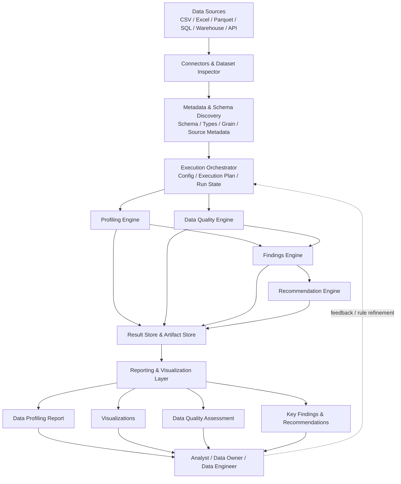
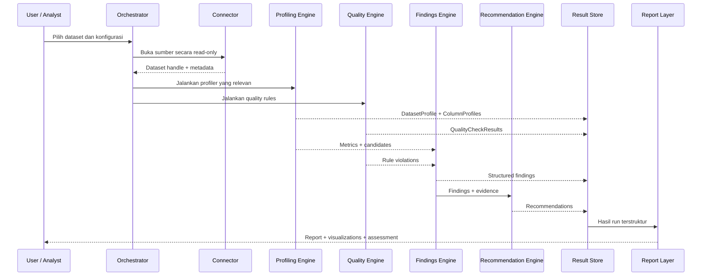

# Data Profiling Engine — Technical Architecture

## 1. Goal dan prinsip desain

Tujuan proyek ini adalah membangun **Data Profiling & Quality Assessment Engine** yang menerima berbagai jenis dataset, menjalankan profiling dan quality checks secara sistematis, lalu menghasilkan:

1. **Data Profiling Report** — ringkasan struktur, karakteristik, statistik, dan distribusi data.
2. **Visualizations** — grafik untuk membantu memahami distribusi, missingness, relasi, dan pola waktu.
3. **Data Quality Assessment** — hasil evaluasi kualitas berdasarkan metrik dan aturan yang dapat dikonfigurasi.
4. **Key Findings** — temuan penting yang dilengkapi bukti dan konteks.
5. **Recommendations** — rekomendasi tindakan yang relevan dengan temuan.

Prinsip desain utama:

- Bangun **modular, metadata-driven engine**, bukan sekadar kumpulan fungsi statistik atau generator dashboard.
- Pisahkan aktivitas **mengukur karakteristik data**, **mengevaluasi kualitas terhadap aturan**, dan **menafsirkan hasil untuk menentukan tindakan**.
- Simpan hasil dalam format terstruktur; HTML/PDF hanya representasi hasil, bukan satu-satunya tempat penyimpanan.
- Setiap temuan harus dapat ditelusuri ke metrik, quality rule, atau bukti yang mendasarinya.
- Setiap eksekusi harus memiliki identitas dan metadata sehingga hasil dapat diaudit, dibandingkan, dan direproduksi.
- Gunakan library yang ada untuk fungsi standar, lalu bangun logic pembeda sendiri pada lapisan konfigurasi, orkestrasi, findings, rekomendasi, dan pelaporan.
- Secara default, engine membaca sumber secara **read-only** dan tidak mengubah atau menghapus data sumber.

## 2. Gambaran arsitektur end-to-end



### 2.1 Batas tanggung jawab komponen

| Modul | Tanggung jawab | Output utama |
|---|---|---|
| **Dataset Inspector** | Membaca metadata skema, tipe, ukuran, dan karakteristik dataset | Dataset metadata |
| **Profiling Engine** | Menghitung statistik, distribusi, pola, relasi, dan kandidat anomali | Profile metrics |
| **Data Quality Engine** | Menjalankan aturan serta mengukur pelanggaran kualitas | Quality assessment |
| **Findings Engine** | Mengolah hasil profiling dan quality checks menjadi temuan bermakna | Structured findings |
| **Recommendation Engine** | Menyarankan tindakan berdasarkan bukti, dampak, dan konteks | Recommended actions |
| **Execution Orchestrator** | Mengatur urutan task, konfigurasi, status, kegagalan, dan pembatalan eksekusi | Execution state |
| **Result Store** | Menyimpan metadata run dan hasil terstruktur | Historical results |
| **Artifact Store** | Menyimpan artefak besar seperti HTML report, grafik, dan file ekspor | Artifact references |
| **Report & Visualization Layer** | Menyajikan hasil untuk analyst dan stakeholder | HTML, PDF, grafik, JSON/API |

### 2.2 Mengapa modul harus dipisahkan?

Misalnya, engine menemukan bahwa kolom `revenue` memiliki 15% nilai kosong.

- **Profiling Engine** mengukur missing rate sebesar 15%.
- **Data Quality Engine** membandingkannya dengan aturan. Jika batas maksimum yang dikonfigurasi adalah 2%, hasil check adalah `FAIL`.
- **Findings Engine** membuat temuan bahwa kelengkapan revenue berpotensi membatasi analisis pendapatan.
- **Recommendation Engine** menyarankan investigasi sumber data, status transaksi, dan proses pengisian revenue.

Keempat hasil ini terkait, tetapi tidak sama. Pemisahan mencegah report hanya menyajikan statistik tanpa penilaian atau menghasilkan rekomendasi tanpa bukti.

## 3. Metadata-driven design

**Keputusan desain utama: perilaku engine sebaiknya dikendalikan oleh konfigurasi dan metadata, bukan hard-coded untuk setiap dataset.**

Hindari pola implementasi seperti:

```python
def profile_customer_data(df):
    ...

def profile_sales_data(df):
    ...

def profile_marketing_data(df):
    ...
```

Pola tersebut berisiko membuat kode berulang dan sulit diperluas. Lebih baik sediakan mekanisme generik yang ditambah konfigurasi dataset serta aturan domain tertentu.

### 3.1 Contoh konfigurasi dataset

```yaml
dataset:
  name: sales_deals
  grain: one_row_per_deal
  primary_key:
    - deal_id

profiling:
  mode: standard
  sections:
    - schema
    - descriptive_statistics
    - missing_values
    - uniqueness
    - distributions
    - correlations
    - temporal
    - relationships

quality_checks:
  - id: deal_id_not_null
    rule: not_null
    column: deal_id
    severity: critical

  - id: deal_id_unique
    rule: unique
    column: deal_id
    severity: critical

  - id: revenue_non_negative
    rule: greater_than_or_equal
    column: revenue
    value: 0
    severity: warning

  - id: closed_deals_have_close_date
    rule: conditional_not_null
    column: closed_at
    condition:
      column: status
      operator: equals
      value: Closed Won
    severity: high
```

Contoh tersebut bersifat ilustratif. Implementasi sebenarnya memerlukan schema konfigurasi yang divalidasi, dokumentasi parameter, dan perilaku yang jelas bila aturan tidak dapat dieksekusi.

### 3.2 Prinsip konfigurasi

- Dataset baru idealnya dapat ditambahkan melalui pendaftaran sumber dan konfigurasi tanpa menulis ulang algoritma profiling.
- Konfigurasi perlu diberi versi dan dicatat pada setiap eksekusi.
- Rule harus mendukung parameter, severity, kondisi, threshold, serta dokumentasi.
- Aturan harus mempertimbangkan semantik bisnis. Misalnya, `revenue` negatif bisa valid untuk refund, reversal, atau penyesuaian akuntansi.
- Konfigurasi yang tidak valid harus ditolak sebelum profiling dimulai, dengan pesan kesalahan yang jelas.

## 4. Kontrak hasil terstruktur

Semua komponen perlu berkomunikasi melalui objek hasil terstruktur. Jangan menjadikan HTML report sebagai satu-satunya penyimpanan hasil.

### 4.1 Objek utama

| Objek | Isi utama |
|---|---|
| `DatasetProfile` | Informasi dataset: row count, column count, schema, periode, grain, dan metadata sumber |
| `ColumnProfile` | Tipe logis, missing rate, distinct count, distribusi, statistik numerik, top categories, dan referensi visualisasi |
| `QualityCheckResult` | Rule ID, status, severity, nilai aktual, threshold, jumlah record gagal, serta bukti pelanggaran |
| `Finding` | Temuan, kategori, bukti, dampak, prioritas, tingkat keyakinan, dan referensi metrik terkait |
| `Recommendation` | Tindakan yang disarankan, alasan, finding terkait, target perbaikan, serta status tindak lanjut |

### 4.2 Metadata minimum setiap run

Setiap eksekusi setidaknya menyimpan:

- `run_id`
- Identitas dataset dan sumber
- Identitas snapshot atau versi data, jika tersedia
- Versi konfigurasi
- Versi engine dan dependensi utama
- Waktu mulai, waktu selesai, serta durasi
- Mode profiling
- Metode sampling dan ukuran sampel, jika digunakan
- Status eksekusi
- Profil hasil dan referensi artefak
- Error log dan peringatan

### 4.3 Manfaat kontrak terstruktur

- Report, dashboard, dan API dapat menggunakan data hasil yang sama.
- Profil dari dua versi dataset dapat dibandingkan.
- Hasil dan rekomendasi dapat ditelusuri ke bukti sumbernya.
- Perubahan format report tidak mengharuskan algoritma profiling ditulis ulang.
- Hasil dapat diuji melalui automated tests.

## 5. Desain Profiling Engine

Profiling Engine sebaiknya terdiri dari profiler modular dengan antarmuka hasil yang konsisten. Tidak semua profiler harus aktif untuk semua dataset.

| Profiler                  | Tugas utama                                                                   |
| ------------------------- | ----------------------------------------------------------------------------- |
| **Schema Profiler**       | Kolom, tipe data, kandidat key, struktur, dan schema drift                    |
| **Statistical Profiler**  | Count, min/max, mean, median, quantile, variance, standard deviation          |
| **Categorical Profiler**  | Frekuensi kategori, kategori langka, cardinality, dan inkonsistensi label     |
| **Missingness Profiler**  | Null, blank, sentinel, dan pola missing bersama                               |
| **Uniqueness Profiler**   | Distinctness, duplicate, dan key uniqueness                                   |
| **Distribution Profiler** | Histogram, skewness, distribusi, dan kandidat outlier                         |
| **Relationship Profiler** | Korelasi, asosiasi, dan functional dependency                                 |
| **Temporal Profiler**     | Tren volume, gap waktu, frekuensi, dan urutan event                           |
| **Relational Profiler**   | Join cardinality, orphan records, dan referential integrity                   |
| **Pattern Profiler**      | Pola teks, format identifier, serta kategori yang tidak sesuai                |
| **Drift Profiler**        | Perubahan skema, distribusi, frekuensi, dan metrik kualitas terhadap baseline |

### 5.1 Pemilihan profiler

Orchestrator memilih profiler berdasarkan:

- Tipe data fisik dan logis
- Konfigurasi dataset
- Tujuan analisis
- Ketersediaan metadata
- Dukungan connector dan execution backend
- Batas waktu, memori, serta biaya komputasi

Contohnya, korelasi numerik tidak perlu dihitung pada setiap kombinasi kolom ketika dataset mempunyai ribuan atribut. Engine perlu mendukung pemilihan kolom, pembatasan pasangan, sampling bila sesuai, dan kebijakan komputasi.

## 6. Pisahkan automated profiling dan quality checks

Sediakan dua jalur eksekusi yang saling melengkapi.

### 6.1 Jalur A — Automated Profiling

Engine mempelajari karakteristik aktual dataset tanpa memerlukan semua aturan bisnis ditulis terlebih dahulu.

Contoh:

- Distribusi numerik
- Missing rate
- Jumlah kategori
- Nilai konstan
- Korelasi
- Frekuensi kategori
- Pola yang tidak lazim

**Tujuan:** discovery dan data understanding.

### 6.2 Jalur B — Rule-Based Quality Checks

Engine mengevaluasi data terhadap aturan eksplisit, konfigurasi dataset, atau kontrak data.

Contoh:

- Primary key harus unik.
- `status` harus termasuk domain nilai yang disepakati.
- Tanggal penutupan wajib tersedia untuk deal yang sudah ditutup.
- Nilai tertentu harus berada dalam rentang yang valid.

**Tujuan:** validasi dan assessment kualitas data.

Profiling tidak otomatis mengetahui apa yang benar menurut bisnis. Missing rate 10% adalah observasi; apakah kondisi tersebut dapat diterima merupakan penilaian berdasarkan aturan dan kebutuhan analisis.

### 6.3 Status quality check

Gunakan status eksplisit:

- `PASS` — pemeriksaan berhasil dijalankan dan aturan terpenuhi.
- `FAIL` — pemeriksaan berhasil dijalankan, tetapi data melanggar aturan.
- `WARN` — hasil menunjukkan kondisi yang perlu ditinjau, tetapi tidak selalu merupakan kegagalan mutlak.
- `ERROR` — pemeriksaan tidak dapat diselesaikan, misalnya karena tipe data tidak cocok atau sumber tidak dapat diakses.

`ERROR` berbeda dari `FAIL`: pada `ERROR`, engine belum berhasil membuktikan apakah data memenuhi aturan.

## 7. Findings & Recommendation Engine

Komponen ini membuat produk lebih bernilai daripada sekadar generator profiling report.

### 7.1 Alur pembentukan temuan

1. Kumpulkan hasil statistik, quality checks, dan perbandingan baseline.
2. Terapkan rule dan pola deteksi untuk menghasilkan kandidat temuan.
3. Gabungkan temuan yang saling berkaitan agar tidak menghasilkan banyak peringatan duplikat.
4. Tentukan severity dan prioritas berdasarkan dampak, bukan hanya threshold.
5. Hubungkan setiap temuan dengan bukti dan rekomendasi yang relevan.

### 7.2 Contoh finding dan rekomendasi

**Finding: Revenue tidak lengkap**

- **Bukti:** 15% dari 20.000 record memiliki `revenue` kosong; batas yang dikonfigurasi adalah 2%.
- **Dampak potensial:** analisis revenue dan perbandingan antarsegmen dapat menjadi bias.
- **Rekomendasi:** periksa kelengkapan field dari sumber CRM dan mekanisme sinkronisasi. Bandingkan missing rate berdasarkan status deal, sumber akuisisi, dan periode sebelum memutuskan perlakuan terhadap record.

### 7.3 Pisahkan fakta, interpretasi, dan dugaan penyebab

- **Fakta:** nilai metrik yang dihitung oleh engine.
- **Interpretasi:** dampak yang mungkin terjadi jika masalah tersebut benar-benar relevan untuk analisis.
- **Dugaan penyebab:** hipotesis yang perlu diverifikasi oleh data owner atau engineer.

AI/LLM dapat membantu menyusun ringkasan, mengelompokkan temuan, atau mengusulkan investigasi. Namun, pengukuran statistik dan keputusan lulus/gagal sebaiknya berasal dari komputasi serta aturan yang dapat direproduksi. Rekomendasi AI harus merujuk pada bukti yang tersedia dan tidak boleh mengarang angka atau menyatakan penyebab yang belum terbukti.

## 8. Pilihan teknologi

Strategi yang disarankan: gunakan library untuk kemampuan standar, kemudian bangun orchestration, standardisasi hasil, findings, recommendation workflow, dan pelaporan sebagai komponen aplikasi sendiri.

### 8.1 Library yang layak dievaluasi

| Kebutuhan | Kandidat | Pertimbangan |
|---|---|---|
| Automated profiling | [YData Profiling](https://docs.profiling.ydata.ai/latest/) | Statistik, distribusi, missing values, korelasi, serta report. Evaluasi kompatibilitas versi, ukuran dataset, dan kebutuhan custom result schema. |
| Data quality checks | [Great Expectations](https://docs.greatexpectations.io/docs/core/introduction/gx_overview/) | Expectations, rule suites, validasi, dan hasil yang dapat dicatat. Cocok bila aturan ingin didokumentasikan dan dijalankan ulang. |
| Alternatif quality checks | [SodaCL](https://docs.soda.io/soda-documentation/soda-v3/soda-cl-overview) | Deklarasi quality checks berbasis YAML dan hasil pemeriksaan. Cocok untuk aturan yang perlu mudah ditulis dan dipelihara. |

**Saran:** mulai dengan YData Profiling untuk mempercepat profiling standar, lalu evaluasi Great Expectations atau Soda sebagai framework quality checks. Pilih salah satu framework quality utama pada tahap awal; tidak perlu memasang keduanya sekaligus tanpa kebutuhan integrasi yang jelas.

Framework eksternal tidak otomatis menyelesaikan kebutuhan produk secara keseluruhan. Findings, recommendation, result contracts, orchestrator, dan workflow report tetap perlu dirancang sesuai kebutuhan aplikasi.

### 8.2 Stack aplikasi awal

| Layer | Pilihan awal | Peran |
|---|---|---|
| Bahasa | Python | Ekosistem data dan integrasi profiling |
| Data processing | Pandas, Polars, atau DuckDB | Pengolahan file dan analisis lokal |
| SQL data access | SQL pushdown melalui connector | Mengurangi pemindahan data yang tidak perlu |
| Profiling library | YData Profiling dan/atau profiler internal tambahan | Statistik dan profil kolom |
| Quality framework | Great Expectations atau Soda | Validasi berbasis aturan |
| API (bila diperlukan) | FastAPI | Integrasi engine dengan aplikasi lain |
| Metadata store | SQLite untuk prototipe lokal; PostgreSQL bila dibutuhkan | Konfigurasi, run history, dan hasil terstruktur |
| Artifact storage | File system lokal untuk desktop; object storage bila perlu | Report, grafik, dan artefak besar |
| Visualization | Plotly atau library visualisasi sejenis | Grafik interaktif |
| Report generation | HTML template, kemudian PDF | Report dan dokumentasi |
| Orchestration | Worker/job runner lokal pada tahap awal | Menjalankan job panjang dengan status yang bisa dipantau |

Pilihan tersebut adalah kandidat awal, bukan kewajiban. Untuk tabel besar di database, gunakan agregasi melalui SQL engine bila memungkinkan. Untuk workload Spark, jangan menarik semua data ke satu Pandas DataFrame hanya untuk menjalankan profiling.

## 9. Strategi eksekusi

Satu algoritma profiling tidak selalu perlu membaca seluruh data ke memori. Sediakan beberapa mode eksekusi.

### 9.1 Quick Profile

- Menggunakan metadata dan statistik dasar.
- Dapat memakai sampling jika sesuai.
- Memprioritaskan gambaran umum dataset dengan cepat.
- Wajib menyatakan bagian mana yang memakai sampling dan metrik mana yang merupakan estimasi.

### 9.2 Standard Profile

- Statistik yang lebih lengkap.
- Missingness, uniqueness, distribusi, dan quality rules utama.
- Temuan awal serta visualisasi yang relevan.
- Menjadi mode default yang seimbang antara detail, kecepatan, dan biaya eksekusi.

### 9.3 Deep Profile

- Relasi antartabel.
- Anomali temporal.
- Pemeriksaan lintas sumber.
- Analisis korelasi atau dependensi yang lebih luas.
- Dipakai saat dibutuhkan karena beberapa operasi dapat mahal secara komputasi.

### 9.4 Strategi pemrosesan

- **Full profiling:** seluruh record diproses ketika diperlukan dan memungkinkan.
- **Sample-based profiling:** sampel digunakan untuk eksplorasi; hasil estimasi perlu diberi label dan keterbatasan.
- **Incremental profiling:** perubahan pada data baru dibandingkan dengan baseline.
- **Pushdown processing:** filter dan agregasi dilakukan pada sumber SQL bila sesuai untuk mengurangi transfer data.

### 9.5 Baseline dan drift

Pisahkan profiling satu kali dengan profiling komparatif. Profiling komparatif membandingkan hasil saat ini dengan baseline historis untuk mendeteksi perubahan volume, skema, distribusi, kelengkapan, dan kualitas.

Baseline harus mencatat konteksnya, termasuk sumber data, periode, konfigurasi, dan metode sampling. Jika metode profiling berubah, perbedaan hasil tidak boleh langsung dianggap sebagai perubahan kualitas data.

## 10. Roadmap implementasi

### Phase 1 — Core MVP

**Target:** profiling end-to-end untuk satu dataset.

Ruang lingkup awal:

- Dukungan CSV, Excel, Parquet, serta satu konektor SQL prioritas.
- Schema detection dan tipe data.
- Statistik dasar dan distribusi.
- Missingness dan uniqueness.
- Quality rules dasar.
- Temuan berbasis aturan.
- Visualisasi dasar.
- Report HTML dan hasil JSON.
- Metadata run serta error log.

**Kriteria selesai:** satu konfigurasi dan satu eksekusi menghasilkan profiling report, quality assessment, temuan, rekomendasi awal, serta metadata run yang dapat ditelusuri.

### Phase 2 — Advanced Profiling

- Profiler spesifik tipe data.
- Analisis hubungan antarkolom.
- Duplicate matching.
- Profiling temporal.
- Validasi lintas tabel.
- Quality scorecard.
- Perbandingan baseline.
- Kustomisasi threshold.

### Phase 3 — Operational Engine

- Background workers.
- Penjadwalan eksekusi.
- API untuk job status.
- Versioning konfigurasi.
- Historical trends.
- Notifikasi temuan.
- Role-based access bila diperlukan.
- Observability untuk eksekusi.

### Phase 4 — Contextual Intelligence

- Metadata bisnis yang lebih kaya.
- Prioritisasi berdasarkan dampak.
- Natural-language summary yang berlandaskan bukti.
- Rekomendasi investigasi yang kontekstual.
- Workflow bagi analyst untuk menerima, menolak, atau mengubah rekomendasi.

## 11. Keputusan arsitektur yang perlu dikunci

| Keputusan | Rekomendasi |
|---|---|
| Arsitektur aplikasi | Mulai dengan **modular monolith**; pisahkan modul dengan jelas tanpa langsung membuat banyak microservices |
| Format hasil | JSON terstruktur sebagai kontrak utama; HTML/PDF adalah representasi hasil |
| Quality score | Tampilkan skor per dimensi dan bukti pada tingkat rule; hindari satu skor global yang tidak transparan |
| Eksekusi | Dukung full scan, sampling, dan pushdown; nyatakan apakah metrik bersifat eksak atau estimasi |
| Rekomendasi | Gunakan rules dan bukti; AI menjadi lapisan pendukung interpretasi |
| Keamanan | Read-only terhadap sumber secara default; kontrol akses dan masking data sensitif dalam report |
| Reproducibility | Simpan versi engine, konfigurasi, source snapshot, metode sampling, dan metadata run |
| Kegagalan eksekusi | Bedakan `FAIL` dari `ERROR`; tampilkan error per task tanpa menyembunyikan bagian yang berhasil |

### Catatan tentang quality score

Jangan menggabungkan seluruh metrik menjadi satu skor kualitas tanpa definisi dimensi, pembobotan, serta kebijakan threshold yang transparan. Skor yang sama dapat menyembunyikan masalah yang sangat berbeda.

### Catatan tentang accuracy

Jangan menyamakan *accuracy* dengan *validity*. Nilai yang memenuhi tipe data dan rentang yang diizinkan belum tentu benar menurut sumber bisnis. Accuracy membutuhkan pembanding atau mekanisme verifikasi tersendiri.

## 12. Struktur direktori kode yang disarankan

```text
data_profiling_engine/
├── connectors/
│   ├── files/
│   ├── sql/
│   └── warehouses/
├── discovery/
│   ├── schema_inference.py
│   ├── semantic_types.py
│   └── dataset_metadata.py
├── profilers/
│   ├── statistical.py
│   ├── categorical.py
│   ├── missingness.py
│   ├── distribution.py
│   ├── relationships.py
│   └── temporal.py
├── quality/
│   ├── rule_registry.py
│   ├── rule_executor.py
│   └── quality_assessment.py
├── findings/
│   ├── detectors.py
│   ├── deduplication.py
│   └── prioritization.py
├── recommendations/
│   ├── rule_based.py
│   └── narrative.py
├── orchestration/
│   ├── execution_plan.py
│   └── runner.py
├── storage/
│   ├── metadata_store.py
│   └── artifact_store.py
├── reporting/
│   ├── visualizations.py
│   ├── html_report.py
│   └── export.py
├── api/
├── schemas/
└── tests/
```

Struktur ini merupakan titik awal dan dapat disesuaikan. Prinsip utamanya: profiler dan quality checks menghasilkan objek terstruktur yang dapat digunakan bersama oleh Findings Engine. Report generator tidak perlu menjalankan ulang algoritma statistik.

## 13. Alur eksekusi yang direkomendasikan



## 14. Checklist untuk menerima MVP

- [ ] Dataset dapat dimuat melalui connector yang didukung.
- [ ] Metadata sumber dan schema tersimpan.
- [ ] Tipe data fisik dan logical type dapat dibedakan bila memungkinkan.
- [ ] Statistik dasar dan distribusi dapat dihitung.
- [ ] Missingness, uniqueness, dan quality rules utama dapat dijalankan.
- [ ] Hasil `PASS`, `FAIL`, `WARN`, dan `ERROR` dibedakan dengan benar.
- [ ] Temuan mempunyai bukti dan referensi ke metrik atau rule terkait.
- [ ] Rekomendasi tidak mengklaim penyebab yang belum dibuktikan.
- [ ] HTML report dan hasil JSON dibuat dari hasil terstruktur yang sama.
- [ ] Run memiliki ID, versi konfigurasi, status, durasi, dan error log.
- [ ] Sampling atau estimasi ditandai secara eksplisit.
- [ ] Sumber tidak diubah oleh proses profiling.
- [ ] Unit tests dan integration tests tersedia untuk profiler serta quality rules utama.

## 15. Rekomendasi akhir

Bangun **engine milik sendiri pada tingkat arsitektur, konfigurasi, hasil, temuan, dan rekomendasi**, tetapi tidak perlu menulis ulang semua fungsi statistik atau validasi yang sudah tersedia di ekosistem Python.

Prioritas pertama adalah membuat siklus berikut berjalan dengan konsisten:

```text
Ingest
  → Inspect
  → Profile
  → Validate
  → Detect Findings
  → Recommend
  → Store Results
  → Generate Outputs
```

Pastikan setiap temuan dapat ditelusuri ke metrik atau rule yang mendasarinya, setiap run dapat direproduksi, dan setiap output dapat digunakan oleh report, dashboard, maupun API. Ini merupakan fondasi agar engine dapat dikembangkan dan digunakan ulang pada berbagai dataset serta kebutuhan bisnis.

## Referensi teknologi

- [YData Profiling documentation](https://docs.profiling.ydata.ai/latest/)
- [Great Expectations — GX overview](https://docs.greatexpectations.io/docs/core/introduction/gx_overview/)
- [SodaCL documentation](https://docs.soda.io/soda-documentation/soda-v3/soda-cl-overview)
