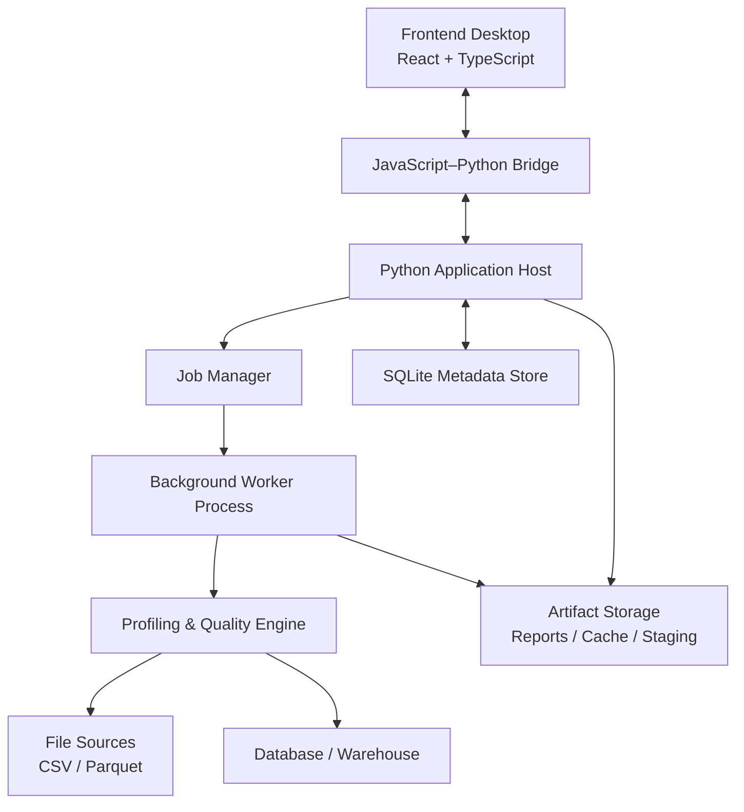
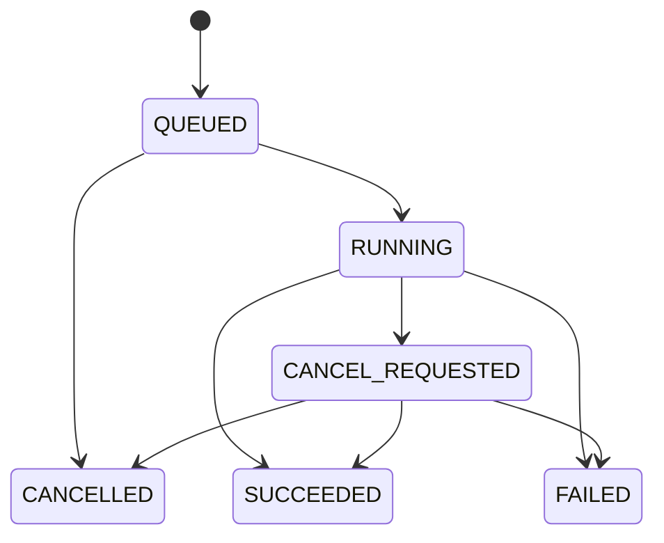
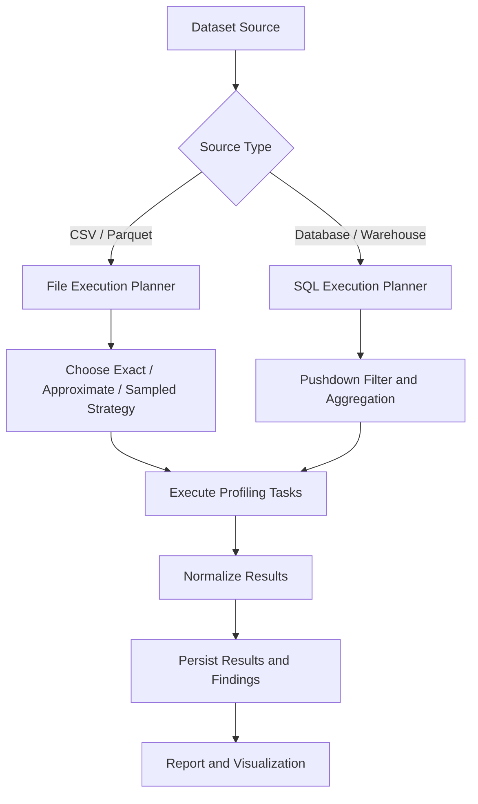

# Evaluasi Keputusan Arsitektur Awal — Data Profiling Engine

## 1. Tujuan

Dokumen ini mengevaluasi konsekuensi teknis dari keputusan arsitektur awal Data Profiling Engine sebelum penyusunan dokumen **Implementation Blueprint untuk Coding Agent**.

Aplikasi dirancang untuk melakukan:

- Data profiling dan exploratory data analysis (EDA).
    
- Data quality checks dan quality assessment.
    
- Visualisasi hasil analisis.
    
- Identifikasi key findings dan rekomendasi.
    
- Pembuatan laporan profiling.
    
- Pemrosesan dataset berukuran 1–100 juta baris.
    
- Analisis data dari file lokal maupun database/data warehouse.
    

## 2. Keputusan Arsitektur Awal

|Aspek|Keputusan|
|---|---|
|Target platform|macOS dan Windows|
|Distribusi|Installer desktop lokal|
|Desktop framework|`pywebview`|
|Frontend|React + TypeScript|
|Backend|Python|
|Komunikasi frontend–backend|JavaScript–Python bridge|
|HTTP/TCP internal|Tidak digunakan|
|Pemrosesan data|DuckDB sebagai kandidat engine utama|
|Transformasi data|Polars secara selektif|
|Metadata persistence|SQLite|
|Background processing|Worker terpisah|
|File formats prioritas|CSV dan Parquet|
|Data sources|File lokal dan database/data warehouse|

### 2.1 Prinsip arsitektur

1. Python menjadi pusat logika aplikasi dan analitik.
    
2. Frontend hanya menangani interaksi pengguna dan presentasi hasil.
    
3. Komunikasi frontend–backend dilakukan melalui bridge native, tanpa REST API atau TCP socket lokal.
    
4. Pemrosesan data berat tidak boleh berjalan pada UI thread.
    
5. Sistem harus mampu menangani dataset besar tanpa memuat seluruh data ke RAM.
    
6. Komponen analitik harus modular, dapat diuji secara independen, dan dapat dikembangkan tanpa mengubah keseluruhan aplikasi.
    
7. Instalasi dan upgrade aplikasi tidak boleh merusak konfigurasi maupun hasil analisis pengguna.
    

---

## 3. Evaluasi Target Platform: macOS dan Windows

### 3.1 Keuntungan

- Aplikasi dapat menjangkau pengguna kedua sistem operasi.
    
- Frontend dan sebagian besar business logic dapat digunakan bersama.
    
- Python menyediakan ekosistem yang kuat untuk data processing dan analytics.
    
- Pengguna tidak harus memasang Python secara manual jika runtime sudah dipaketkan.
    

### 3.2 Konsekuensi teknis

|Area|Konsekuensi|Mitigasi|
|---|---|---|
|WebView|Engine dan perilaku dapat berbeda antar-OS|Pengujian UI pada kedua platform|
|Python dependencies|Library native mungkin membutuhkan binary berbeda|Build terpisah per OS|
|File system|Path dan izin file berbeda|Gunakan API path lintas platform|
|Credential storage|Mekanisme keamanan berbeda|Gunakan credential store native|
|Installer|Format paket dan prosedur instalasi berbeda|Siapkan pipeline build terpisah|
|Security|macOS dan Windows memiliki mekanisme keamanan berbeda|Uji signing, izin, dan kebijakan deployment|
|Upgrade|File aplikasi dan data pengguna memiliki siklus hidup berbeda|Pisahkan direktori instalasi dan data|

### 3.3 Strategi build

Build harus dilakukan pada lingkungan native masing-masing platform.

- macOS: build dan validasi paket macOS.
    
- Windows: build dan validasi paket Windows.
    
- Uji installer, startup, operasi file, database connection, bridge, dan proses worker pada masing-masing OS.
    
- Periksa signing dan notarization untuk distribusi macOS jika diperlukan.
    
- Periksa ketersediaan WebView2 Runtime dan kebijakan deployment pada Windows.
    

> [!IMPORTANT]  
> Jangan menganggap aplikasi yang berhasil berjalan dalam development environment otomatis dapat berjalan setelah dipaketkan sebagai installer.

---

## 4. Evaluasi Distribusi: Installer Desktop Lokal

### 4.1 Keuntungan

- Pengguna memperoleh aplikasi yang dapat dijalankan secara lokal.
    
- Runtime Python dan dependency dapat dikelola oleh aplikasi.
    
- Pemrosesan file dapat dilakukan tanpa mengirimkan data ke layanan cloud.
    
- Metadata, konfigurasi, dan hasil profiling dapat disimpan secara lokal.
    

### 4.2 Konsekuensi teknis

Installer perlu menangani:

- Packaging Python runtime dan dependency.
    
- Packaging frontend assets.
    
- Dependency native, termasuk library analitik.
    
- WebView runtime atau dependency terkait.
    
- Direktori data dan cache.
    
- Upgrade versi aplikasi.
    
- Pemulihan setelah aplikasi crash.
    
- Uninstall tanpa penghapusan data pengguna secara tidak sengaja.
    

### 4.3 Pemisahan direktori

Direktori harus dipisahkan berdasarkan fungsi.

|Direktori|Fungsi|
|---|---|
|Application directory|Executable dan library aplikasi|
|User data directory|Konfigurasi, metadata, dan riwayat profiling|
|Cache directory|Cache yang dapat dibuat ulang|
|Temporary workspace|File staging dan artefak sementara|
|Export directory|Laporan yang diekspor pengguna|

Direktori tersebut harus ditentukan menggunakan lokasi standar sistem operasi, bukan hard-coded path.

### 4.4 Strategi packaging

`PyInstaller` dapat menjadi kandidat awal untuk packaging Python, dengan build terpisah untuk macOS dan Windows.

Evaluasi packaging perlu meliputi:

- Ukuran installer.
    
- Waktu startup.
    
- Dependency resolution.
    
- Native library compatibility.
    
- Antivirus false positive.
    
- Signing dan notarization.
    
- Upgrade dan rollback.
    
- Ketersediaan runtime WebView.
    

Referensi: [PyInstaller Documentation](https://pyinstaller.org/en/stable/)

---

## 5. Evaluasi Framework Desktop: pywebview

### 5.1 Keuntungan

`pywebview` cocok untuk aplikasi yang menggabungkan frontend berbasis web dengan backend Python.

Keuntungan utama:

- JavaScript dapat berkomunikasi dengan Python melalui bridge.
    
- Tidak membutuhkan REST API lokal untuk komunikasi internal.
    
- Python tetap menjadi pusat orkestrasi aplikasi.
    
- React dan TypeScript dapat digunakan untuk membangun UI yang kaya.
    
- Integrasi dengan library analitik Python relatif langsung.
    

### 5.2 Konsekuensi teknis

|Area|Konsekuensi|Mitigasi|
|---|---|---|
|WebView engine|Perilaku rendering berbeda antar-platform|Pengujian lintas OS|
|JavaScript–Python bridge|API yang terlalu luas meningkatkan risiko keamanan|Expose facade terbatas|
|Threading|Operasi panjang dapat menyebabkan UI tidak responsif|Gunakan worker terpisah|
|Payload|Transfer data besar melalui bridge tidak efisien|Kirim agregat dan halaman hasil|
|Frontend routing|SPA harus kompatibel dengan pemuatan aset lokal|Uji routing tanpa local HTTP server|
|Packaging|Development mode berbeda dari production mode|Uji build installer secara langsung|

### 5.3 Batas tanggung jawab

`pywebview` bertanggung jawab atas:

- Window management.
    
- WebView hosting.
    
- JavaScript–Python bridge.
    
- Integrasi desktop dasar.
    

`pywebview` bukan:

- Data processing engine.
    
- Job scheduler analitik.
    
- Database management system.
    
- Mekanisme otomatis untuk mengisolasi dan memulihkan worker.
    

### 5.4 Rekomendasi

Gunakan `pywebview` sebagai desktop host, sedangkan logika aplikasi, job management, dan pemrosesan data ditempatkan pada modul Python yang terpisah.

Referensi:

- [pywebview](https://pywebview.flowrl.com/)
    
- [JavaScript–Python Bridge](https://pywebview.idepy.com/en/guide/interdomain)
    
- [Web Engine Compatibility](https://pywebview.idepy.com/en/guide/web_engine)
    

---

## 6. Arsitektur Komunikasi Internal Tanpa HTTP/TCP

### 6.1 Prinsip

Komunikasi antara frontend dan backend menggunakan JavaScript–Python bridge yang disediakan `pywebview`.

Arsitektur tidak menggunakan:

- Local REST API.
    
- Local FastAPI server untuk komunikasi UI–backend.
    
- TCP socket sebagai kanal internal aplikasi.
    
- HTTP polling melalui localhost.
    

Pemuatan frontend juga harus dirancang agar tidak bergantung pada local HTTP server sebagai kanal aplikasi. Gunakan aset lokal dan validasi kompatibilitas pemuatan file, SPA routing, serta bridge pada build produksi.

> [!NOTE]  
> Larangan HTTP/TCP berlaku pada komunikasi internal aplikasi. Koneksi database atau data warehouse jarak jauh tetap dapat menggunakan protokol jaringan yang diwajibkan oleh sumber data tersebut.

### 6.2 Diagram arsitektur



### 6.3 Tanggung jawab komponen

|Komponen|Tanggung jawab|
|---|---|
|Frontend|Input pengguna, dashboard, tabel, visualisasi|
|Bridge|Command, response, dan event antara JavaScript dan Python|
|Application Host|Validasi request, orchestration, application lifecycle|
|Job Manager|Job ID, status, pembatalan, timeout, recovery|
|Worker Process|Pemrosesan data berat|
|Profiling Engine|Statistik, distribusi, profiling, quality checks|
|SQLite|Metadata, konfigurasi, riwayat eksekusi|
|Artifact Storage|File sementara, laporan, dan hasil ekspor|

---

## 7. Bridge Contract

Bridge harus menjadi antarmuka aplikasi yang eksplisit, bukan mekanisme untuk mengekspos sembarang fungsi Python.

### 7.1 Contoh command

|Command|Fungsi|
|---|---|
|`dataset.inspect`|Memeriksa struktur dataset|
|`dataset.preview`|Mengambil preview terbatas|
|`profile.start`|Memulai profiling|
|`profile.get_status`|Memeriksa status job|
|`profile.cancel`|Meminta pembatalan job|
|`quality.get_results`|Mengambil hasil quality checks|
|`report.get_summary`|Mengambil ringkasan laporan|
|`artifact.open`|Membuka atau mengekspor artefak yang diizinkan|

### 7.2 Pola request dan response

Contoh konseptual:

```
{
  "command": "profile.start",
  "request_id": "req-001",
  "payload": {
    "dataset_id": "dataset-001",
    "profile_mode": "standard"
  }
}
```

Response awal:

```
{
  "request_id": "req-001",
  "status": "accepted",
  "job_id": "job-001"
}
```

Contoh status job:

```
{
  "job_id": "job-001",
  "status": "RUNNING",
  "progress": {
    "completed_steps": 3,
    "total_steps": 8
  }
}
```

Contoh error:

```
{
  "request_id": "req-001",
  "status": "error",
  "error": {
    "code": "DATASET_READ_FAILED",
    "message": "Dataset could not be read."
  }
}
```

Contoh di atas merupakan kontrak konseptual, bukan implementasi final. Skema final harus didefinisikan dan divalidasi secara formal.

### 7.3 Ketentuan wajib

- Setiap request memiliki ID.
    
- Setiap job panjang memiliki `job_id`.
    
- Request dan response menggunakan schema tervalidasi.
    
- Error menggunakan kode yang konsisten.
    
- Payload dibatasi ukurannya.
    
- Data besar tidak dikirim melalui bridge sebagai satu objek.
    
- Semua command memvalidasi izin dan argumen.
    
- Bridge tidak mengekspos akses filesystem atau Python secara bebas.
    
- Event dan status job memiliki format yang konsisten.
    

---

## 8. Background Worker dan Job Lifecycle

### 8.1 Mengapa worker terpisah?

Dataset 1–100 juta baris dapat membutuhkan waktu dan sumber daya yang signifikan.

Jika analisis dijalankan pada jalur UI:

- UI dapat menjadi tidak responsif.
    
- Crash analitik dapat memengaruhi kestabilan aplikasi.
    
- Pembatalan pekerjaan menjadi lebih sulit.
    
- Penggunaan memori sulit dikendalikan.
    
- Pekerjaan yang panjang sulit dipulihkan.
    

Karena itu, pemrosesan berat sebaiknya berjalan dalam proses worker terpisah.

### 8.2 Job lifecycle



Status akhir harus didefinisikan dengan jelas. `CANCEL_REQUESTED` menunjukkan permintaan pembatalan, bukan jaminan bahwa pekerjaan sudah berhenti.

### 8.3 Fitur minimum Job Manager

- Start job.
    
- Retrieve job status.
    
- Progress reporting.
    
- Cancel job.
    
- Timeout handling.
    
- Error reporting.
    
- Worker crash detection.
    
- Cleanup temporary artifacts.
    
- Persistensi status penting.
    
- Recovery saat aplikasi dijalankan kembali.
    

### 8.4 Thread versus process

|Aspek|Thread|Process|
|---|---|---|
|Overhead|Lebih rendah|Lebih tinggi|
|Isolasi crash|Terbatas|Lebih baik|
|Isolasi memori|Tidak terpisah|Terpisah|
|Pembatalan paksa|Sulit dan berisiko|Lebih terkelola|
|Komunikasi|Shared memory/queue|IPC internal atau queue|
|Rekomendasi|Operasi ringan|Analitik berat|

Rekomendasi awal: gunakan proses worker terpisah untuk profiling dan quality checks yang berat.

Proses worker dapat menggunakan mekanisme IPC lokal yang sesuai tanpa membuat HTTP server atau TCP socket. Detail implementasi harus mempertimbangkan kebutuhan multiprocessing pada macOS dan Windows.

---

## 9. Strategi Data Processing untuk 1–100 Juta Baris

### 9.1 File-based analytics

DuckDB menjadi kandidat utama untuk memproses CSV dan Parquet.

Manfaat yang diharapkan:

- Pemrosesan kolumnar.
    
- Agregasi data besar.
    
- Query langsung terhadap file yang didukung.
    
- Dukungan untuk strategi pemrosesan berbasis disk.
    
- Pengurangan kebutuhan memuat seluruh dataset ke memori Python.
    

Polars dapat digunakan secara selektif untuk transformasi yang sesuai.

### 9.2 Database dan data warehouse

Untuk sumber data eksternal:

1. Gunakan koneksi read-only secara default.
    
2. Ambil metadata dan schema terlebih dahulu.
    
3. Susun execution plan sesuai kemampuan sumber data.
    
4. Jalankan filter dan agregasi di sisi database jika memungkinkan.
    
5. Transfer hanya agregat, sampel, atau batch yang diperlukan.
    
6. Hindari mengambil seluruh tabel ke RAM hanya untuk menghitung statistik sederhana.
    

### 9.3 Execution strategy



### 9.4 Mode profiling

|Mode|Tujuan|Catatan|
|---|---|---|
|Quick Profile|Gambaran cepat dataset|Sampel atau estimasi harus ditandai|
|Standard Profile|Statistik dan quality checks inti|Exact atau approximate sesuai metrik|
|Deep Profile|Analisis lanjutan|Hubungan antar-kolom, temporal, dan lintas tabel|

Setiap hasil harus menunjukkan apakah metrik dihitung secara exact, approximate, sampled, atau tidak dihitung.

> [!IMPORTANT]  
> Jangan mengklaim hasil sampel sebagai hasil exact. Metode, cakupan, dan keterbatasan perhitungan harus tercatat dalam hasil profiling.

---

## 10. Metadata Persistence dan Artifact Storage

### 10.1 SQLite

SQLite cocok sebagai metadata store awal untuk aplikasi desktop single-user.

Data yang disimpan dapat meliputi:

- Dataset registry.
    
- Dataset metadata.
    
- Profiling run.
    
- Job status.
    
- Quality check results.
    
- Configuration versions.
    
- Engine version.
    
- Finding dan recommendation metadata.
    
- Riwayat eksekusi.
    

### 10.2 Artifact storage

Artefak besar sebaiknya disimpan sebagai file terpisah, bukan sebagai blob besar dalam tabel metadata.

Contoh:

- Profiling report.
    
- Hasil ekspor JSON.
    
- Laporan HTML.
    
- File staging Parquet.
    
- Visualisasi yang diekspor.
    
- Log atau diagnostic artifacts yang aman.
    

SQLite menyimpan metadata dan referensi artefak.

### 10.3 Pemisahan lifecycle

- Data aplikasi harus bertahan saat aplikasi di-upgrade.
    
- Cache harus dapat dibuat ulang.
    
- Temporary files harus memiliki kebijakan cleanup.
    
- Hasil ekspor pengguna tidak boleh dihapus tanpa tindakan eksplisit.
    
- Perubahan skema metadata harus memiliki mekanisme migration.
    

---

## 11. Security Contract

### 11.1 Bridge security

- Expose hanya API yang diperlukan.
    
- Validasi seluruh input.
    
- Jangan mengekspos `eval`, akses Python arbitrer, atau filesystem arbitrer.
    
- Batasi command berdasarkan daftar yang diizinkan.
    
- Hindari menyisipkan data tidak tepercaya ke JavaScript tanpa encoding yang benar.
    
- Jangan memuat konten eksternal yang tidak tepercaya dengan hak bridge.
    

### 11.2 Credential security

- Gunakan credential store yang sesuai dengan OS.
    
- Hindari menyimpan password dalam teks biasa.
    
- Jangan memasukkan credential ke log, error message, atau report.
    
- Dukung penghapusan koneksi dan credential tersimpan.
    
- Gunakan koneksi read-only secara default.
    

### 11.3 Data security

- Batasi akses file pada lokasi yang dipilih atau diizinkan pengguna.
    
- Masking atau redaksi data sensitif dalam laporan jika diperlukan.
    
- Terapkan cleanup file sementara.
    
- Hindari menyimpan data mentah yang tidak diperlukan.
    
- Berikan kontrol terhadap cache, staging, dan riwayat lokal.
    

---

## 12. Performance dan Benchmark Contract

Keberhasilan arsitektur tidak cukup dinilai dari aplikasi yang dapat dibuka. Engine harus diuji dengan workload realistis.

### 12.1 Variabel pengujian

- Jumlah baris.
    
- Jumlah kolom.
    
- Ukuran file.
    
- Cardinality kolom.
    
- Missingness.
    
- Jumlah nilai unik.
    
- Distribusi data.
    
- Jumlah quality rules.
    
- Kompleksitas query.
    
- Sumber data dan latensi.
    
- Penggunaan RAM dan disk.
    
- Pembatalan job.
    
- Beberapa job dalam satu sesi.
    

### 12.2 Metrik penerimaan

|Metrik|Tujuan|
|---|---|
|Correctness|Memastikan hasil sesuai perhitungan referensi|
|Wall-clock time|Mengukur waktu eksekusi|
|Peak memory|Mengendalikan penggunaan RAM|
|Disk usage|Mengukur kebutuhan staging dan cache|
|Source query cost|Menghindari beban berlebihan pada database|
|UI responsiveness|Memastikan UI tetap responsif|
|Cancellation latency|Mengukur waktu respons pembatalan|
|Recovery|Memastikan crash worker tidak merusak metadata|
|Reproducibility|Memastikan hasil dapat ditelusuri ke konfigurasi dan versi engine|

Target numerik harus ditentukan setelah benchmark awal pada perangkat dan dataset representatif. Jangan menetapkan batas waktu universal sebelum karakteristik workload diketahui.

---

## 13. Testing Strategy

### 13.1 Unit tests

Uji secara terpisah:

- Profilers.
    
- Quality rules.
    
- Schema inference.
    
- Finding detection.
    
- Recommendation logic.
    
- Result normalization.
    
- Configuration validation.
    
- Job state transitions.
    

### 13.2 Integration tests

Uji:

- Frontend–Python bridge.
    
- Python host–worker communication.
    
- Worker–DuckDB integration.
    
- Database connector.
    
- SQLite persistence.
    
- Artifact lifecycle.
    
- Cancellation dan timeout.
    
- Error propagation.
    

### 13.3 Desktop tests

Uji pada macOS dan Windows:

- Application startup.
    
- File dialogs.
    
- Pemilihan file besar.
    
- SPA routing dengan aset lokal.
    
- Bridge invocation.
    
- UI responsiveness selama job.
    
- Instalasi bersih.
    
- Upgrade versi.
    
- Uninstall.
    
- Reopen aplikasi dan recovery.
    
- WebView runtime compatibility.
    

### 13.4 Acceptance criteria

- Aplikasi berjalan pada macOS dan Windows.
    
- Installer dapat dipasang pada lingkungan yang didukung.
    
- Komunikasi internal tidak menggunakan local HTTP/TCP.
    
- Profiling berjalan di worker, bukan UI thread.
    
- UI tetap responsif saat job berjalan.
    
- Job dapat dipantau dan dibatalkan.
    
- Error worker tidak merusak metadata store.
    
- Dataset besar diproses tanpa memuat seluruh data ke RAM.
    
- Hasil exact, approximate, dan sampled dibedakan dengan jelas.
    
- Credential tidak muncul di log.
    
- Upgrade tidak menghapus data pengguna.
    
- Benchmark dan hasil pengujian terdokumentasi.
    

---

## 14. Architecture Decision Records (ADR)

Keputusan berikut perlu dicatat secara formal.

|ADR|Keputusan|Status|
|---|---|---|
|ADR-001|Target macOS dan Windows|Dipilih|
|ADR-002|Distribusi menggunakan installer lokal|Dipilih|
|ADR-003|`pywebview` sebagai desktop host|Dipilih|
|ADR-004|React + TypeScript sebagai frontend|Baseline|
|ADR-005|JavaScript–Python bridge tanpa HTTP/TCP internal|Wajib|
|ADR-006|Worker process untuk analitik berat|Rekomendasi|
|ADR-007|DuckDB sebagai kandidat file analytics engine|Rekomendasi|
|ADR-008|SQLite untuk metadata persistence|Rekomendasi|
|ADR-009|PyInstaller sebagai kandidat packaging|Perlu validasi|
|ADR-010|Aset frontend lokal untuk produksi|Wajib diuji|

Setiap ADR final sebaiknya mencantumkan:

- Context.
    
- Decision.
    
- Alternatives considered.
    
- Consequences.
    
- Risks.
    
- Validation criteria.
    

---

## 15. Risiko Utama dan Mitigasi

|Risiko|Dampak|Mitigasi|
|---|---|---|
|WebView berbeda antar-OS|UI tidak konsisten|Cross-platform test suite|
|Bridge terlalu luas|Risiko keamanan|Typed command facade|
|Worker crash|Job gagal|Process isolation dan recovery|
|RAM tidak terkendali|Aplikasi crash|Query planning, streaming, disk-based execution|
|Full data transfer dari database|Biaya dan latensi tinggi|SQL pushdown|
|Installer gagal|Aplikasi tidak dapat dijalankan|Build dan smoke test native|
|Credential bocor|Risiko keamanan|Native credential store|
|Temporary files menumpuk|Disk penuh|Cleanup policy|
|Hasil tidak reproducible|Sulit diaudit|Versioned configs dan run metadata|
|Klaim exact pada hasil sampel|Kesimpulan salah|Provenance dan method metadata|

---

## 16. Rekomendasi Keputusan Final

Pilihan awal dinilai layak untuk dijadikan baseline pengembangan.

### Keputusan yang dipertahankan

1. macOS dan Windows sebagai target resmi.
    
2. Installer desktop lokal.
    
3. `pywebview` sebagai desktop host.
    
4. React + TypeScript sebagai frontend.
    
5. Python sebagai backend utama.
    
6. JavaScript–Python bridge sebagai komunikasi internal.
    
7. Tidak menggunakan local REST API atau TCP socket untuk komunikasi internal.
    
8. Worker terpisah untuk analitik berat.
    
9. DuckDB sebagai kandidat utama pemrosesan file.
    
10. SQLite sebagai metadata store awal.
    

### Syarat sebelum implementasi

- Bridge contract harus didefinisikan.
    
- Job lifecycle harus ditetapkan.
    
- Strategi proses worker harus diputuskan.
    
- Struktur direktori aplikasi dan data harus ditentukan.
    
- Packaging dan installer harus diuji pada kedua OS.
    
- Strategi profiling untuk dataset besar harus dibenchmark.
    
- Security contract dan credential handling harus didefinisikan.
    
- Acceptance criteria harus disepakati.
    

---

## 17. Struktur Dokumen Implementation Blueprint

Setelah evaluasi ini, dokumentasi untuk coding agent sebaiknya disusun dalam beberapa dokumen yang saling melengkapi.

```
docs/
├── IMPLEMENTATION_BLUEPRINT.md
├── ARCHITECTURE.md
├── ARCHITECTURE_DECISIONS.md
├── DOMAIN_AND_CONTRACTS.md
├── BRIDGE_PROTOCOL.md
├── JOB_LIFECYCLE.md
├── PROFILING_ENGINE.md
├── QUALITY_RULE_CATALOG.md
├── DATA_SOURCE_CONNECTORS.md
├── PERSISTENCE_AND_ARTIFACTS.md
├── SECURITY.md
├── PACKAGING_AND_DEPLOYMENT.md
├── TESTING_AND_ACCEPTANCE.md
├── PERFORMANCE_BENCHMARKS.md
└── IMPLEMENTATION_PLAN.md

AGENTS.md
```

### Peran masing-masing dokumen

|Dokumen|Isi utama|
|---|---|
|`IMPLEMENTATION_BLUEPRINT.md`|Spesifikasi implementasi end-to-end|
|`ARCHITECTURE.md`|Layer, modul, dependency, dan diagram|
|`ARCHITECTURE_DECISIONS.md`|ADR dan konsekuensi keputusan|
|`DOMAIN_AND_CONTRACTS.md`|Model domain dan schema|
|`BRIDGE_PROTOCOL.md`|Command, response, event, dan error|
|`JOB_LIFECYCLE.md`|State machine, cancel, timeout, recovery|
|`PROFILING_ENGINE.md`|Algoritma dan execution strategy|
|`QUALITY_RULE_CATALOG.md`|Definisi, parameter, dan hasil quality rules|
|`DATA_SOURCE_CONNECTORS.md`|File connectors dan database connectors|
|`PERSISTENCE_AND_ARTIFACTS.md`|Metadata, migration, cache, dan artefak|
|`SECURITY.md`|Bridge, credential, file access, dan logging|
|`PACKAGING_AND_DEPLOYMENT.md`|Build, installer, upgrade, dan release|
|`TESTING_AND_ACCEPTANCE.md`|Test plan dan acceptance criteria|
|`PERFORMANCE_BENCHMARKS.md`|Workload, benchmark, dan batas performa|
|`IMPLEMENTATION_PLAN.md`|Tahapan implementasi dan dependency|
|`AGENTS.md`|Instruksi kerja coding agent dan batas arsitektur|

## 18. Kesimpulan

Arsitektur `pywebview` + React + TypeScript + Python merupakan baseline yang masuk akal untuk Data Profiling Engine desktop.

Kelayakan implementasi bergantung pada empat aspek kritis:

1. **Komunikasi:** bridge yang eksplisit, tervalidasi, dan tanpa HTTP/TCP lokal.
    
2. **Eksekusi:** worker process yang terpisah dari UI.
    
3. **Performa:** execution planning yang menghindari pemuatan dataset besar secara penuh ke memori.
    
4. **Distribusi:** build, installer, dan pengujian yang benar-benar tervalidasi pada macOS dan Windows.
    

Dengan keputusan ini, langkah berikutnya adalah menyusun Implementation Blueprint yang mendefinisikan kontrak domain, struktur modul, API bridge, lifecycle job, algoritma profiling, quality rules, penyimpanan, pengujian, serta tahapan implementasi secara presisi.

**Prinsip utama:** coding agent harus mengikuti kontrak arsitektur yang ditetapkan, bukan membuat keputusan fundamental sendiri saat implementasi.