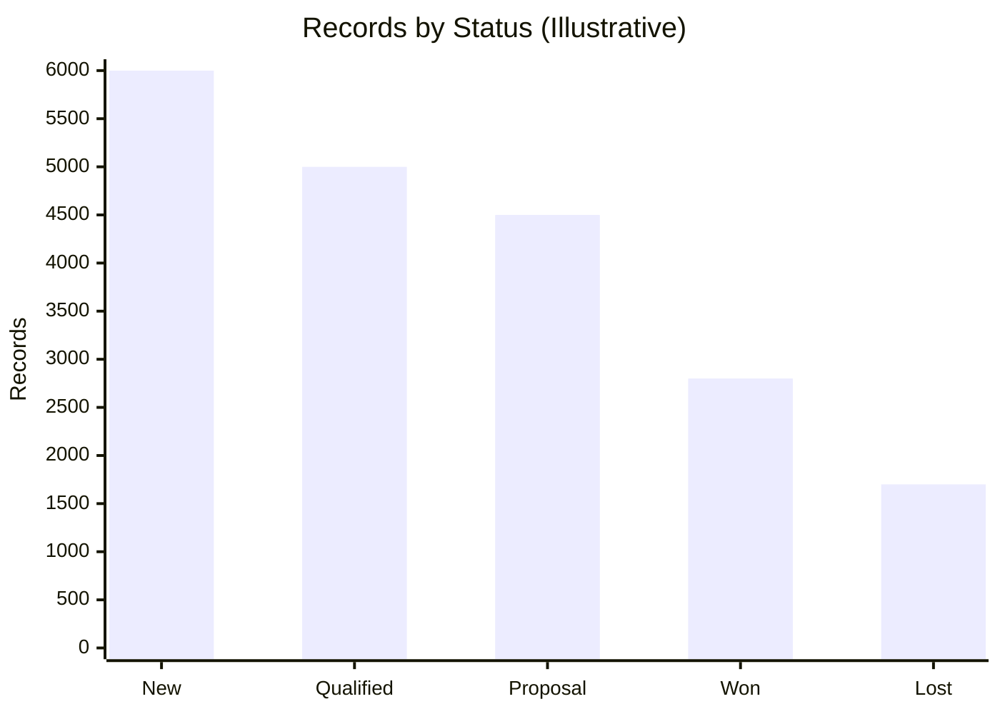
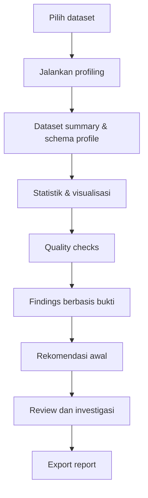

# Expected Output — Data Profiling Engine MVP vs Final App

## 1. Tujuan dokumen

Dokumen ini mendefinisikan **output yang diharapkan dari Data Profiling Engine** pada dua tahap pengembangan:

- **MVP (Minimum Viable Product):** aplikasi sudah dapat memprofilkan satu dataset secara end-to-end dan menghasilkan hasil yang bisa digunakan.
- **Final App:** aplikasi berkembang menjadi platform profiling interaktif yang mendukung konfigurasi, investigasi, perbandingan historis, dan tindak lanjut temuan.

Fokus dokumen ini adalah apa yang **dilihat dan dapat dilakukan oleh pengguna**, bukan hanya daftar komponen teknis di belakang aplikasi.

> [!NOTE] Data simulasi
> Semua nama file, angka, statistik, temuan, dan nilai contoh dalam dokumen ini bersifat ilustratif untuk mendemonstrasikan expected output. Nilai ini bukan hasil profiling dari file nyata.

## 2. Dataset contoh

Gunakan satu dataset simulasi yang sama untuk menggambarkan output aplikasi: `sales_deals.csv`, berisi data sales pipeline perusahaan SaaS.

### 2.1 Ringkasan dataset

| Properti | Contoh |
|---|---|
| Nama dataset | `sales_deals.csv` |
| Jumlah record | 20.000 |
| Jumlah kolom | 8 |
| Domain bisnis | Sales pipeline |
| Grain | Satu baris per deal |
| Profiling run | `DP-0001` |

### 2.2 Kolom dataset

| Kolom | Tipe logis yang diharapkan | Keterangan |
|---|---|---|
| `deal_id` | Identifier | ID unik deal |
| `lead_id` | Identifier | ID lead terkait |
| `source` | Categorical | Sumber akuisisi |
| `created_at` | Datetime | Tanggal deal dibuat |
| `status` | Categorical | Status pipeline penjualan |
| `deal_value` | Numeric / Currency | Nilai deal |
| `closed_at` | Datetime | Tanggal deal ditutup |
| `sales_rep_id` | Identifier | Salesperson yang menangani |

---

# 3. Expected Output untuk MVP App

MVP sebaiknya sudah memberikan hasil yang berguna setelah pengguna memilih dataset dan menjalankan **Run Profiling**. Empat area output utama yang disarankan adalah:

1. Dataset Overview
2. Schema & Column Profiling
3. Visualizations
4. Data Quality Assessment & Findings

## 3.1 Dataset Overview

Contoh tampilan ringkasan hasil profiling:

### Data Profiling Overview

| Item | Contoh output |
|---|---:|
| Dataset | `sales_deals.csv` |
| Profiling run | `DP-0001` |
| Total rows | 20.000 |
| Total columns | 8 |
| Quality checks evaluated | 7 |
| Checks passed | 3 |
| Checks failed | 3 |
| Warnings | 1 |

Contoh ringkasan status:

- `PASS`: 3
- `FAIL`: 3
- `WARN`: 1
- `ERROR`: 0

> [!IMPORTANT] Makna status
> Jumlah PASS/FAIL/WARN/ERROR di atas adalah contoh tujuh quality checks yang dievaluasi, bukan skor universal kualitas dataset. **FAIL** berarti aturan berhasil dijalankan tetapi data melanggar aturan; **ERROR** berarti pemeriksaan tidak berhasil diselesaikan.

Dashboard overview harus menjawab pertanyaan:

- Dataset apa yang sedang dianalisis?
- Berapa jumlah record dan kolomnya?
- Apakah ada masalah kualitas yang perlu diperhatikan?
- Bagian mana yang harus diperiksa lebih lanjut?

Untuk MVP, ringkasan yang benar, mudah dibaca, dan dapat ditelusuri lebih penting daripada dashboard yang kompleks.

## 3.2 Schema & Column Profiling

MVP menampilkan daftar kolom dan karakteristik utamanya. Pengguna dapat memilih sebuah kolom untuk melihat detail profil.

| Column | Type | Missing | Contoh hasil / finding | Status ilustratif |
|---|---|---:|---|---|
| `deal_id` | Identifier | 0% | 12 repeated keys; 24 record terdampak | Issue |
| `lead_id` | Identifier | 0% | Profil keunikan tersedia | OK |
| `source` | Categorical | 0% | 5 kategori | OK |
| `created_at` | Datetime | 0% | Cakupan waktu tersedia | OK |
| `status` | Categorical | 0% | 5 kategori valid | OK |
| `deal_value` | Numeric | 15% | 3.000 nilai kosong | Issue |
| `closed_at` | Datetime | 40% | Perlu validasi kondisional | Review |
| `sales_rep_id` | Identifier | 1,2% | 240 nilai kosong | Review |

> [!NOTE] Interpretasi missing value
> Missing rate global `closed_at` sebesar 40% belum tentu merupakan masalah karena deal yang belum ditutup memang bisa tidak mempunyai tanggal penutupan. Kualitas kolom tersebut perlu dinilai berdasarkan kondisi bisnis, misalnya `closed_at` wajib terisi ketika `status = Closed Won`.

### 3.2.1 Detail profil kolom numerik

Contoh statistik untuk 17.000 nilai `deal_value` yang tersedia:

| Metric | Contoh output |
|---|---:|
| Total rows | 20.000 |
| Valid count | 17.000 |
| Missing count | 3.000 |
| Missing rate | 15% |
| Mean | US$18.450 |
| Median | US$6.800 |
| Minimum | US$0 |
| Maximum | US$980.000 |
| 95th percentile | US$82.000 |

Angka tersebut hanya contoh tampilan. Engine nyata harus menghitung nilai tersebut dari dataset yang dipilih. Report juga perlu mencantumkan satuan atau mata uang bila sudah diketahui; jika belum diketahui, satuan harus ditandai sebagai belum dikonfirmasi.

### 3.2.2 Detail profil kolom

Untuk kolom yang dipilih, detail MVP minimal dapat mencakup:

- Descriptive statistics: count, min, max, mean, median, standard deviation, dan quantiles sesuai tipe data.
- Histogram atau frequency distribution.
- Missing-value count dan persentase.
- Distinct count dan cardinality.
- Kandidat nilai ekstrem atau outlier.
- Sampel record yang bermasalah, dengan pembatasan informasi sensitif.

## 3.3 Visualizations

MVP idealnya membuat visualisasi otomatis sesuai tipe data.

### Visualisasi 1 — Records by status

Contoh distribusi record berdasarkan status deal:

| Status | Records |
|---|---:|
| New | 6.000 |
| Qualified | 5.000 |
| Proposal | 4.500 |
| Closed Won | 2.800 |
| Closed Lost | 1.700 |
| **Total** | **20.000** |

Representasi Mermaid yang sederhana:



### Visualisasi 2 — Missing rate per kolom

| Kolom | Missing rate |
|---|---:|
| `deal_value` | 15% |
| `sales_rep_id` | 1,2% |
| `closed_at` | 40% |

`closed_at` perlu ditafsirkan secara kondisional; persentase missing global saja tidak cukup untuk menentukan apakah kualitasnya buruk.

### Visualisasi yang layak dimasukkan ke MVP

- Histogram untuk kolom numerik.
- Frequency chart untuk kolom kategorikal.
- Missing-value chart.
- Box plot atau ringkasan outlier sederhana.
- Korelasi numerik dasar bila relevan dan jumlah kolom memungkinkan.

Tidak semua visualisasi perlu dibuat untuk setiap kolom. Jenis visualisasi sebaiknya dipilih berdasarkan tipe data dan potensi manfaatnya.

## 3.4 Data Quality Assessment & Findings

Contoh hasil quality checks:

| Rule | Status | Bukti |
|---|---|---|
| `deal_id_not_null` | PASS | Tidak ada ID kosong |
| `deal_id_unique` | FAIL | 12 key berulang; 24 record terdampak |
| `deal_value_missing_rate` | FAIL | Missing rate 15%; batas yang dikonfigurasi 5% |
| `status_valid` | PASS | Semua status termasuk domain yang diperbolehkan |
| `closed_won_has_closed_at` | FAIL | 186 dari 2.800 Closed Won tidak memiliki tanggal penutupan |
| `sales_rep_id_missing_rate` | PASS | Missing rate 1,2%; batas yang dikonfigurasi 2% |
| `deal_value_outlier_scan` | WARN | 47 kandidat nilai ekstrem perlu ditinjau |

### Finding F-001 — Revenue tidak lengkap

- **Severity:** High
- **Bukti:** 15% nilai `deal_value` kosong, melampaui batas 5%.
- **Dampak potensial:** analisis revenue dan perbandingan antarsegmen dapat menjadi bias.
- **Rekomendasi:** periksa missing rate berdasarkan status, source, dan periode; investigasi proses pengiriman data dari sumber. Jangan langsung mengisi nilai kosong dengan nol.

### Finding F-002 — Duplikasi ID deal

- **Severity:** High
- **Bukti:** 12 key berulang yang melibatkan 24 record.
- **Dampak potensial:** jumlah deal atau metrik terkait dapat terhitung ganda jika duplikasi tidak ditangani dengan benar.
- **Rekomendasi:** periksa apakah masalah berasal dari duplikasi ingestion, perubahan record, atau definisi grain yang keliru sebelum memutuskan record mana yang dipertahankan.

### Finding F-003 — Tanggal penutupan tidak lengkap

- **Severity:** High
- **Bukti:** 186 deal berstatus `Closed Won` tidak mempunyai `closed_at`.
- **Dampak potensial:** perhitungan sales cycle dan tren closing dapat menjadi tidak akurat.
- **Rekomendasi:** verifikasi bahwa `closed_at` memang wajib diisi untuk deal yang berhasil ditutup; periksa sumber dan proses sinkronisasi sebelum menggunakan field tersebut untuk menghitung sales cycle.

## 3.5 Output yang wajib dapat diekspor dari MVP

MVP sekurang-kurangnya menghasilkan:

- **HTML report** — report yang mudah dibaca pengguna.
- **JSON result** — hasil profiling, quality checks, dan findings yang terstruktur dan dapat digunakan program lain.
- **CSV issue export** — daftar isu untuk tindak lanjut oleh analyst atau data owner.

MVP belum harus memiliki AI insight yang kompleks, custom rule builder visual, atau analisis lintas banyak tabel. Namun, kontrak hasil harus dirancang agar fitur tersebut dapat ditambahkan nanti.

---

# 4. Expected Output untuk Final App

Final App berkembang dari alat pemeriksaan satu dataset menjadi **platform data profiling yang interaktif, configurable, dapat membandingkan histori, dan menuntun pengguna dari temuan ke investigasi**.

Area utama yang direkomendasikan:

1. Executive Data Overview
2. Interactive Profiling Explorer
3. Advanced Data Quality Assessment
4. Baseline & Drift Analysis
5. Findings & Recommendations Workspace
6. Final Reporting & Export

## 4.1 Executive Data Overview

Contoh ringkasan final app:

| Item | Contoh output |
|---|---:|
| Dataset | `sales_deals` |
| Current run | `DP-0048` |
| Quality checks | 42 dari 48 lulus |
| Failed checks | 4 |
| Warnings | 2 |
| Open findings | 8 |
| High-priority findings | 2 |
| Profile dimensions | 12 |
| Historical runs | 48 |
| Baseline comparison | Aktif |

Angka final app di atas adalah contoh terpisah untuk menunjukkan tampilan yang lebih matang, bukan kelanjutan aritmetika dari contoh MVP.

Final App dapat menyediakan workspace berbeda menurut kebutuhan:

- **Executive overview:** kondisi keseluruhan, temuan prioritas, tren, dan kesiapan analisis.
- **Analyst workspace:** detail kolom, distribusi, visualisasi, serta investigasi record.
- **Data quality workspace:** rules, hasil validasi, threshold, owner, dan status perbaikan.
- **Run history:** perubahan profil dari satu eksekusi ke eksekusi berikutnya.

## 4.2 Interactive Profiling Explorer

Pada MVP, pengguna terutama membaca hasil profiling. Pada Final App, pengguna dapat memilih kolom dan mengeksplorasi detailnya.

### Contoh detail `deal_value`

- Missing rate: 15%
- Valid values: 17.000
- Mean, median, quantiles, dan rentang nilai
- Histogram distribusi
- Kandidat outlier
- Perbandingan missing rate atau distribusi antarsegmen
- Contoh record bermasalah
- Relasi ke findings dan quality rules terkait

### Contoh detail `source`

- Missing rate
- Jumlah kategori berbeda
- Frequency rank dan proporsi setiap kategori
- Rare categories
- Variasi label yang mungkin inkonsisten
- Distribusi menurut status deal

### Contoh detail `created_at`

- Rentang tanggal
- Jumlah record per hari, minggu, atau bulan
- Gap periode
- Tanggal di luar rentang yang diharapkan
- Perbandingan tren dengan baseline

### Contoh detail `deal_id`

- Distinctness dan uniqueness
- Kelompok key berulang
- Record yang mempunyai key sama
- Hubungan key dengan tabel lain, jika tersedia
- Export daftar record yang perlu ditinjau

Explorer memungkinkan analyst menjawab pertanyaan lanjutan tanpa harus mengulangi profiling manual dari awal.

## 4.3 Advanced Data Quality Assessment

| Kapabilitas | MVP | Final App |
|---|---|---|
| Null dan blank checks | Pemeriksaan bawaan | Aturan dapat dikonfigurasi |
| Validasi tipe dan rentang | Aturan dasar | Aturan khusus kolom dan domain |
| Conditional rules | Sejumlah aturan tetap | Rule builder dan ekspresi tervalidasi |
| Primary / foreign key | Kandidat dasar | Relasi lintas tabel |
| Severity | Nilai default | Dapat dikonfigurasi |
| Quality score | Indikator sederhana | Skor per dimensi dengan bobot transparan |
| Baseline | Belum wajib | Histori dan perbandingan run |
| Issue management | Daftar temuan | Owner, status, komentar, tindak lanjut |
| Rule versioning | Versi awal konfigurasi | Riwayat perubahan aturan dan hasilnya |

### Prinsip quality score

- Nilai setiap dimensi kualitas secara terpisah, misalnya completeness, uniqueness, validity, consistency, dan timeliness.
- Tampilkan rule-level evidence dan denominator yang digunakan.
- Dokumentasikan bobot dan threshold jika skor gabungan disediakan.
- Jangan biarkan banyak aturan minor yang lulus menutupi kegagalan aturan kritis.
- Jangan menyamakan *validity* dengan *accuracy*: nilai yang memenuhi tipe dan rentang belum tentu benar menurut sumber bisnis.

## 4.4 Baseline & Drift Analysis

Final App dapat membandingkan run saat ini dengan baseline historis.

| Metric | Baseline | Current run | Perubahan |
|---|---:|---:|---|
| Record count | 18.500 | 20.000 | +8,1% |
| `deal_value` missing rate | 8% | 15% | +7 percentage points |
| Duplicate-key count | 3 | 12 | +9 key |
| Valid status categories | 5 | 5 | Tidak berubah |

Angka tersebut merupakan simulasi.

Jenis drift yang dapat dipantau:

- **Schema drift:** kolom bertambah, hilang, atau berubah tipe.
- **Volume drift:** jumlah record berubah secara tidak biasa.
- **Distribution drift:** distribusi numerik atau kategorikal berubah.
- **Quality drift:** missing rate, duplicate rate, atau pelanggaran rules berubah.
- **Temporal drift:** pola waktu atau keterlambatan data berubah.

Drift adalah sinyal untuk investigasi, bukan bukti otomatis bahwa data salah. Baseline harus menyimpan konteks seperti sumber, periode, konfigurasi, dan metode sampling. Perubahan metode profiling tidak boleh keliru dianggap sebagai perubahan kualitas data.

## 4.5 Findings & Recommendations Workspace

Final App sebaiknya menambahkan detail terstruktur pada setiap temuan.

| Field | Fungsi |
|---|---|
| `finding_id` | Identitas temuan yang stabil |
| `title` / `summary` | Ringkasan masalah |
| `evidence` | Metrik, rule, record, atau perbandingan baseline yang mendukung |
| `scope` | Kolom, tabel, periode, dan jumlah record terdampak |
| `severity` | Critical, high, medium, atau low |
| `confidence` | Tingkat keyakinan terhadap interpretasi |
| `potential_impact` | Dampak terhadap analisis atau operasi |
| `recommendation` | Tindakan yang disarankan |
| `related_findings` | Temuan lain yang berkaitan |
| `owner` / `status` | Pemilik tindakan dan progres |
| `resolution_evidence` | Bukti bahwa masalah ditangani atau risikonya diterima |

### Contoh ringkasan yang dihasilkan

> Kelengkapan `deal_value` menurun dibandingkan baseline sebelumnya. Investigasi lebih lanjut diperlukan untuk menentukan apakah perubahan terkonsentrasi pada source, status deal, atau periode tertentu sebelum nilai revenue digunakan untuk membandingkan efektivitas kanal.

Ringkasan seperti ini hanya boleh menyatakan pola spesifik jika memang didukung hasil profiling. Jika belum ada bukti yang cukup, sistem harus menyatakannya sebagai pertanyaan investigasi, bukan sebagai kesimpulan.

## 4.6 Final Reporting & Export

### Executive Report

Berisi ringkasan kondisi data, temuan prioritas, dampak potensial, dan tindakan yang disarankan.

### Detailed Profiling Report

Berisi profil dataset, semua atribut, statistik, distribusi, visualisasi, dan metadata.

### Data Quality Assessment Report

Berisi rules, status, threshold, quality scorecard, findings, dan histori pelanggaran.

### Machine-readable Results

- JSON untuk integrasi dan proses otomatis.
- CSV untuk issue log atau data tabular yang perlu ditinjau di spreadsheet.
- HTML untuk report interaktif atau mudah dibagikan.
- PDF jika ada kebutuhan report statis atau dokumentasi formal.

---

# 5. Perbandingan MVP dan Final App

| Kapabilitas | MVP | Final App |
|---|---|---|
| Input data | Upload file dan konektor prioritas | Beragam file dan sumber data |
| Dataset inspection | Schema, tipe, ukuran, metadata dasar | Metadata lebih kaya dan semantic types |
| Profiling | Statistik dan distribusi utama | Profiling lanjutan dan hubungan yang lebih luas |
| Quality checks | Rules standar | Rule registry dan konfigurasi fleksibel |
| Visualisasi | Grafik otomatis dasar | Explorer interaktif dan perbandingan segmen |
| Findings | Rules dan template berbasis bukti | Penggabungan temuan, prioritisasi, dan konteks |
| Rekomendasi | Tindak lanjut generik sesuai temuan | Rekomendasi kontekstual dan workflow penyelesaian |
| Baseline | Belum wajib | Histori dan drift detection |
| Relasi tabel | Terbatas atau belum tersedia | Join, key relationships, referential integrity |
| Reporting | HTML, JSON, CSV | Report yang dapat disesuaikan, termasuk PDF bila diperlukan |
| Operasional | Run manual | Run history, scheduling, monitoring, dan kontrol akses |
| AI assistance | Belum diperlukan | Ringkasan berbasis bukti dengan kontrol yang jelas |

## 5.1 Fokus MVP

MVP harus menghasilkan semua kategori output utama, tetapi dengan cakupan yang terbatas:

- Satu dataset per run.
- Beberapa sumber file dan konektor prioritas.
- Profil struktur, statistik, missingness, uniqueness, dan distribusi.
- Quality checks dasar.
- Findings berbasis bukti dan rekomendasi awal.
- Visualisasi dasar.
- Ekspor HTML, JSON, dan CSV.

MVP tidak harus memiliki AI insight kompleks, custom rule builder visual, deep cross-table profiling, scheduling, atau workflow kolaborasi.

## 5.2 Fokus Final App

Final App menambahkan kemampuan lanjutan tanpa perlu mengubah kontrak dasar hasil:

- Konfigurasi yang lebih fleksibel.
- Profiling relasi antardataset.
- Analisis baseline dan drift.
- Investigasi record yang lebih mendalam.
- Quality score per dimensi.
- Temuan yang diprioritaskan.
- Workflow tindak lanjut dengan owner dan status.
- Run history, scheduling, monitoring, dan akses pengguna.
- AI assistance yang dibatasi pada interpretasi berbasis bukti.

---

# 6. Output Minimum yang Wajib Dimiliki MVP

MVP belum harus mempunyai semua kemampuan Final App, tetapi harus memberikan alur lengkap berikut:



### Checklist MVP

- [ ] Pengguna dapat memilih dan memuat dataset.
- [ ] Aplikasi menampilkan dataset summary dan schema profile.
- [ ] Aplikasi menghasilkan statistik dan visualisasi otomatis.
- [ ] Aplikasi menjalankan quality checks.
- [ ] Status `PASS`, `FAIL`, `WARN`, dan `ERROR` dibedakan dengan benar.
- [ ] Temuan memiliki bukti dan referensi ke metrik atau rule terkait.
- [ ] Rekomendasi tidak menyatakan penyebab yang belum terbukti.
- [ ] Pengguna dapat meninjau detail temuan.
- [ ] HTML report dan JSON result dihasilkan dari hasil terstruktur yang sama.
- [ ] CSV issue export tersedia.
- [ ] Setiap run memiliki ID, status, konfigurasi, durasi, dan error log.
- [ ] Sampling atau estimasi ditandai secara eksplisit.
- [ ] Sumber data tidak diubah oleh proses profiling.

# 7. Prinsip Desain Output

## 7.1 Evidence-first

Setiap finding dan rekomendasi harus mengarah ke bukti yang bisa dilacak, misalnya metrik, rule ID, daftar record, distribusi, atau perbandingan baseline.

## 7.2 Pisahkan fakta dan interpretasi

- **Fact:** angka atau hasil yang benar-benar dihitung.
- **Interpretation:** kemungkinan makna atau dampak terhadap analisis.
- **Hypothesis:** dugaan penyebab yang perlu diverifikasi.
- **Recommendation:** tindakan yang disarankan berikut alasan dan bukti pendukungnya.

## 7.3 Jangan melakukan perbaikan otomatis secara diam-diam

Profiling dan quality assessment sebaiknya mengidentifikasi masalah, bukan otomatis menghapus duplikasi, mengganti nilai kosong, atau mengubah sumber data. Perbaikan otomatis, jika kelak ditambahkan, harus menjadi workflow terpisah dengan preview, persetujuan, audit trail, serta kemampuan membandingkan sebelum dan sesudah.

## 7.4 Nyatakan keterbatasan hasil

- Tandai metrik yang dihitung dari sampling.
- Nyatakan denominator dan definisi setiap rate.
- Jangan menyimpulkan accuracy hanya dari validity checks.
- Jangan menyimpulkan sebab-akibat dari korelasi.
- Tandai dugaan dan temuan yang membutuhkan validasi bisnis.

# 8. Rekomendasi Akhir

Desain MVP agar sejak versi pertama dapat menghasilkan seluruh kategori output utama, tetapi dengan kedalaman yang terbatas. Final App kemudian memperluas konfigurasi, relasi antardataset, analisis historis, prioritisasi, dan workflow tanpa mengubah kontrak dasar hasil.

Alur inti yang disarankan:

```text
Load Dataset
  → Inspect
  → Profile
  → Validate
  → Detect Findings
  → Recommend
  → Store Results
  → Generate Outputs
```

Dengan pendekatan ini:

- **MVP menjawab:** “Apa karakteristik data dan masalah apa yang ditemukan?”
- **Final App menjawab:** “Seberapa penting masalahnya, apa bukti dan dampaknya, bagaimana menelusuri penyebabnya, dan tindakan apa yang perlu dilakukan?”

Keberhasilan produk bergantung pada hasil yang akurat, transparan, reproducible, dan dapat ditelusuri—bukan pada banyaknya grafik atau kecanggihan narasi semata.
